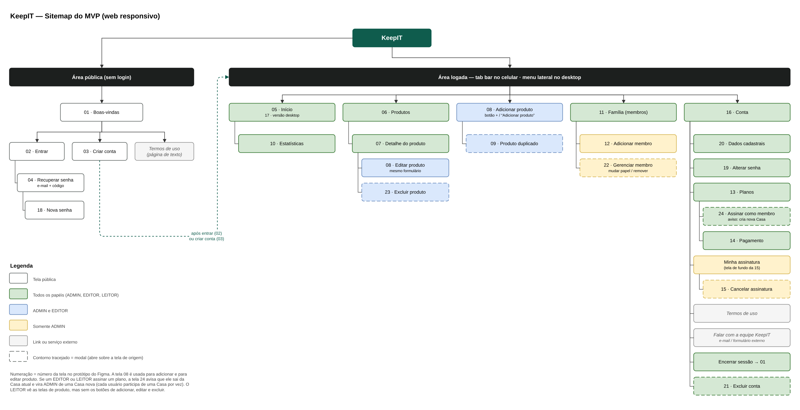

# 1. Modelagem do Produto

## 1.1 Sitemap

O sitemap apresenta a organização das telas do KeepIT e os caminhos de navegação entre elas. Ele foi refeito a partir do protótipo do MVP, que passou a ter 24 telas depois da conferência com os casos de uso (UC001 a UC037). Como o MVP é uma aplicação web responsiva, a mesma estrutura vale para o celular, onde a navegação principal é feita pela barra inferior (tab bar), e para o desktop, onde ela é feita por um menu lateral. A Figura 1 mostra o sitemap completo.

**Figura 1: Sitemap do MVP do KeepIT**

Fonte: Autoria própria apoiado por IA generativa (Claude, Anthropic), 2026.

A estrutura do sitemap se organiza da seguinte forma:

(i) **Área pública:** reúne as telas acessíveis sem login. A partir da tela de Boas-vindas (01), o usuário pode entrar (02), criar uma conta (03) ou ler os Termos de uso. A recuperação de senha acontece em duas telas: a confirmação do e-mail com código de 6 dígitos (04) e a definição da nova senha (18). Ao criar a conta, o sistema gera automaticamente uma Casa com o plano Individual, gratuito.

(ii) **Área logada:** depois do login ou do cadastro, o usuário passa a navegar pelas cinco entradas principais: Início, Produtos, Adicionar produto, Família e Conta. No celular, essas entradas ficam na barra inferior, com o botão central "+" para adicionar produto. No desktop, ficam no menu lateral (tela 17).

(iii) **Início e Estatísticas:** o Início (05) resume a Casa, com o valor total do patrimônio, o uso de armazenamento, a data de renovação da assinatura e os últimos produtos adicionados. Dele o usuário acessa as Estatísticas (10): maior gasto, valor médio, tag mais comprada e valor por tag.

(iv) **Produtos:** a lista de produtos (06) leva ao detalhe de cada produto (07). Do detalhe, o usuário pode editar o produto, reaproveitando o formulário da tela 08, ou excluí-lo após uma confirmação (23).

(v) **Adicionar produto:** o formulário (08) recebe foto, nome, descrição, preço, quantidade, data de compra e tags. Se já existir um produto com o mesmo nome na Casa, o sistema abre o aviso de produto duplicado (09), com as opções de somar à quantidade, cadastrar mesmo assim ou cancelar.

(vi) **Família:** a tela de membros (11) mostra quem faz parte da Casa, o papel de cada um e o limite de membros do plano. O ADMIN pode adicionar um membro (12) e, pelo menu de cada membro, mudar o papel ou removê-lo da Casa (22).

(vii) **Conta e assinatura:** a tela de Conta (16) leva aos dados cadastrais (20), à alteração de senha (19), aos Planos (13), à assinatura atual, aos Termos de uso, ao contato com a equipe, ao encerramento da sessão e à exclusão da conta (21). Todos os papéis podem consultar os planos e contratar um por meio do pagamento (14). Como cada usuário participa de uma Casa por vez, quando um EDITOR ou LEITOR assina um plano o sistema mostra um aviso (24): ele sai da Casa atual e passa a ser o ADMIN de uma Casa nova, e os produtos que cadastrou permanecem na Casa anterior. Já a tela de assinatura atual e o cancelamento (15) são exclusivos do ADMIN, que é o titular do pagamento.

(viii) **Controle por papel:** as cores do sitemap indicam quem pode acessar cada tela. Telas em verde são visíveis para todos os papéis; em azul, apenas para ADMIN e EDITOR; em amarelo, somente para o ADMIN. O LEITOR navega pelas mesmas telas de consulta, mas sem os botões de adicionar, editar e excluir. Telas com contorno tracejado são modais, que abrem sobre a tela de origem.

A Tabela 1 resume as telas por área do sitemap.

**Tabela 1: Telas do MVP por área do sitemap**

| Área | Telas | Acesso |
|---|---|---|
| Área pública | 01 Boas-vindas, 02 Entrar, 03 Criar conta, 04 Recuperar senha, 18 Nova senha | Sem login |
| Início | 05 Início, 17 Início (desktop), 10 Estatísticas | Todos os papéis |
| Produtos | 06 Produtos, 07 Detalhe do produto | Todos os papéis |
| Produtos (edição) | 08 Adicionar/Editar produto, 09 Produto duplicado, 23 Excluir produto | ADMIN e EDITOR |
| Família | 11 Família (membros) | Todos os papéis |
| Família (gestão) | 12 Adicionar membro, 22 Gerenciar membro | Somente ADMIN |
| Conta | 16 Conta, 19 Alterar senha, 20 Dados cadastrais, 21 Excluir conta | Todos os papéis |
| Planos | 13 Planos, 14 Pagamento, 24 Assinar como membro | Todos os papéis |
| Assinatura atual | Minha assinatura, 15 Cancelar assinatura | Somente ADMIN |

Fonte: Autoria própria apoiado por IA generativa (Claude, Anthropic), 2026.

Com essa organização, todas as funções do MVP ficam a no máximo três níveis abaixo da navegação principal, e as permissões de cada papel aparecem já na estrutura de navegação. O sitemap serve de base para os wireframes e para o protótipo, apresentados nas próximas seções, e para a divisão do sistema em módulos na Arquitetura de Software.
