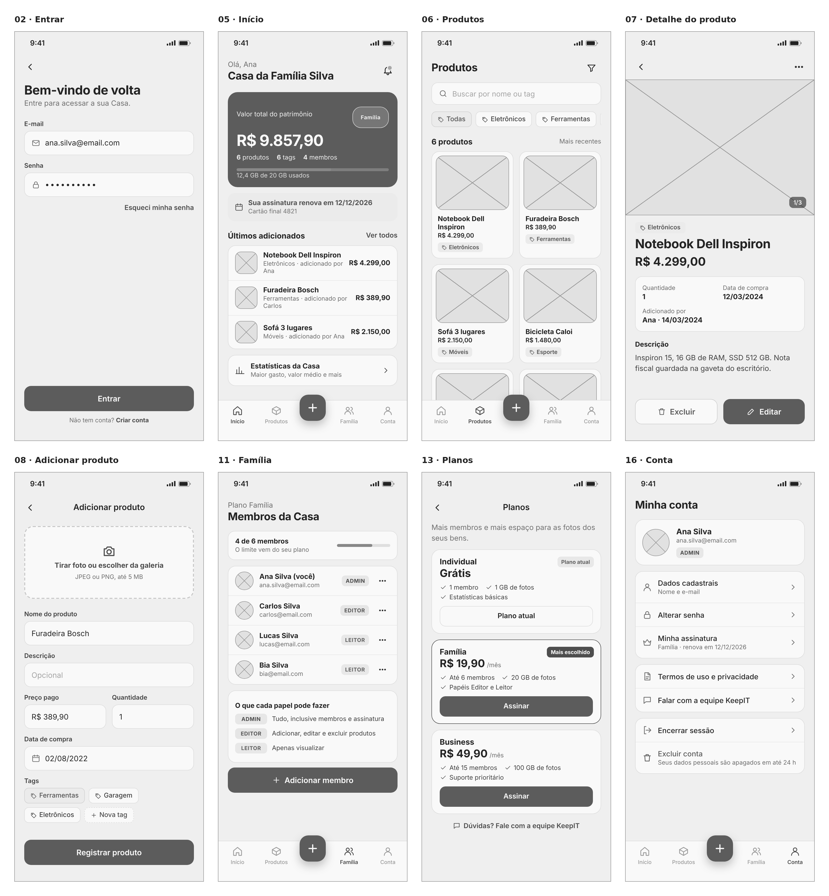
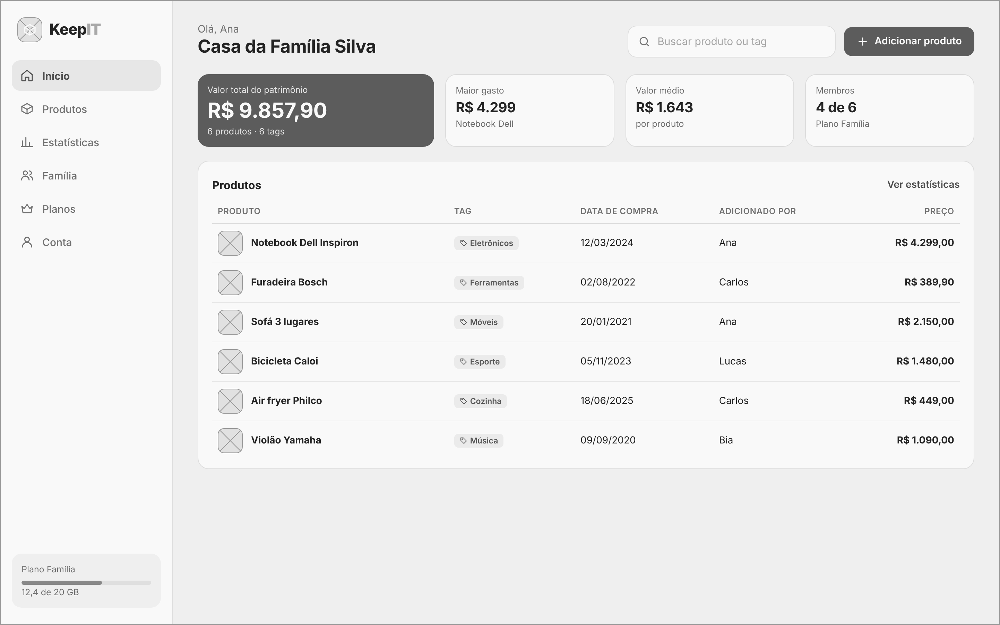

## 1.2 Wireframe

Os wireframes mostram a estrutura das telas do KeepIT em baixa fidelidade, sem cores, fotos ou identidade visual. O objetivo é validar a posição dos elementos, a hierarquia das informações e os caminhos de navegação antes do acabamento visual do protótipo. Foram selecionadas as oito telas que concentram as funções principais do MVP no celular (Figura 2) e a tela inicial na versão desktop (Figura 3). As demais telas seguem os mesmos padrões e aparecem no protótipo, apresentado na seção 1.3.

**Figura 2: Wireframes das telas principais (celular)**

Fonte: Autoria própria apoiado por IA generativa (Claude, Anthropic), 2026.

**Figura 3: Wireframe da tela inicial (desktop)**

Fonte: Autoria própria apoiado por IA generativa (Claude, Anthropic), 2026.

Os wireframes seguem estes padrões de interface:

(i) **Navegação principal fixa:** no celular, a barra inferior traz Início, Produtos, Família e Conta, com o botão central "+" para adicionar produto, a ação mais frequente do app. No desktop, as mesmas entradas ficam no menu lateral, que também mostra o uso de armazenamento do plano.

(ii) **Informação mais importante no topo:** o Início abre com o valor total do patrimônio da Casa em destaque, seguido do aviso de renovação da assinatura e dos últimos produtos adicionados. No desktop, os indicadores (valor total, maior gasto, valor médio e membros) ficam lado a lado, e a lista de produtos vira uma tabela com colunas.

(iii) **Foto como elemento central do produto:** na lista de Produtos, cada item aparece como um cartão com foto, nome, preço e tag. No detalhe, a foto ocupa o topo da tela. No cadastro, o primeiro campo é o envio da foto.

(iv) **Formulários curtos e em uma coluna:** Entrar, Adicionar produto e as demais telas de formulário usam campos empilhados com rótulo acima, e o botão de ação principal fica fixo na parte de baixo da tela, ao alcance do polegar.

(v) **Ações por papel:** os botões de adicionar, editar e excluir aparecem apenas para ADMIN e EDITOR. Em Família, o ADMIN vê o botão "Adicionar membro" e o menu de cada membro. Em Conta, o ADMIN vê o item "Minha assinatura"; para EDITOR e LEITOR, esse item é trocado por "Planos".

(vi) **Ações destrutivas separadas:** excluir produto, cancelar assinatura e excluir conta usam botões com contorno, em posição secundária, e sempre pedem confirmação em um modal antes de serem executadas.

A Tabela 2 resume o objetivo e os elementos principais de cada wireframe.

**Tabela 2: Wireframes e seus elementos principais**

| Tela | Objetivo | Elementos principais |
|---|---|---|
| 02 Entrar | Acessar a conta | E-mail, senha, "Esqueci minha senha", botão Entrar, link para criar conta |
| 05 Início | Resumo da Casa | Valor total do patrimônio, uso de armazenamento, aviso de renovação, últimos produtos, atalho para Estatísticas |
| 06 Produtos | Consultar o inventário | Busca por nome ou tag, filtro por tag, grade de cartões com foto, nome, preço e tag |
| 07 Detalhe do produto | Ver um produto | Foto, tag, nome, preço, quantidade, data de compra, quem adicionou, descrição, botões Excluir e Editar |
| 08 Adicionar produto | Cadastrar um produto | Envio de foto, nome, descrição, preço, quantidade, data de compra, tags |
| 11 Família | Ver os membros da Casa | Limite de membros do plano, lista com papel de cada membro, explicação dos papéis, botão Adicionar membro |
| 13 Planos | Comparar e assinar planos | Cartões dos planos Individual, Família e Business com preço, benefícios e botão Assinar |
| 16 Conta | Gerenciar a conta | Perfil, dados cadastrais, senha, assinatura ou planos, termos, contato, encerrar sessão, excluir conta |
| 17 Início (desktop) | Resumo da Casa em tela larga | Menu lateral, busca, botão Adicionar produto, quatro indicadores, tabela de produtos |

Fonte: Autoria própria apoiado por IA generativa (Claude, Anthropic), 2026.

Com a estrutura validada nos wireframes, o protótipo aplica a identidade visual do KeepIT sobre o mesmo layout, sem mudar a posição dos elementos. Isso mantém o wireframe, o protótipo e o sitemap coerentes entre si e serve de referência direta para a implementação das telas em React.
