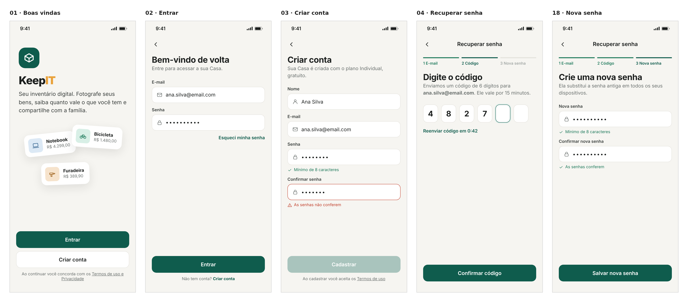
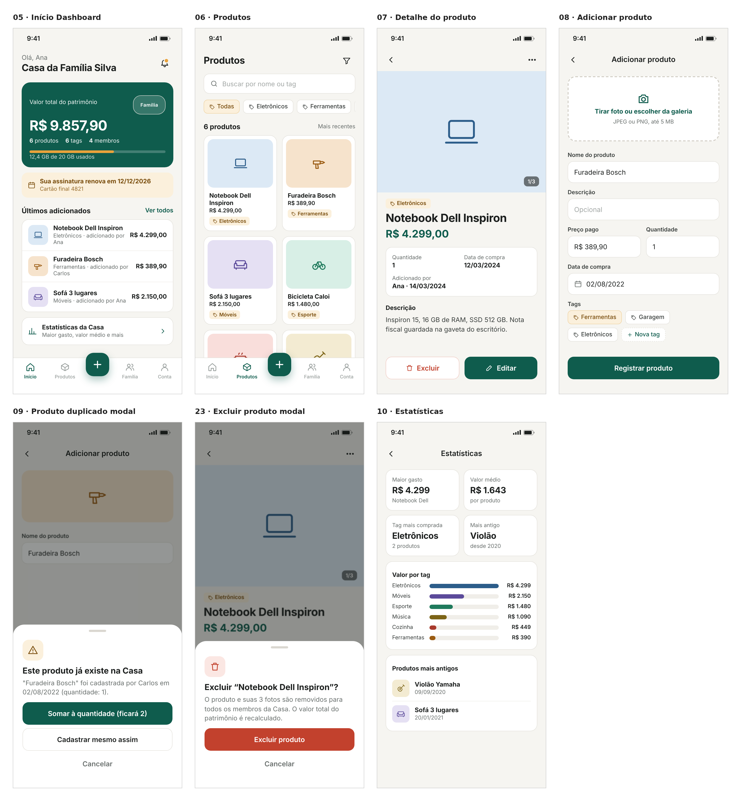
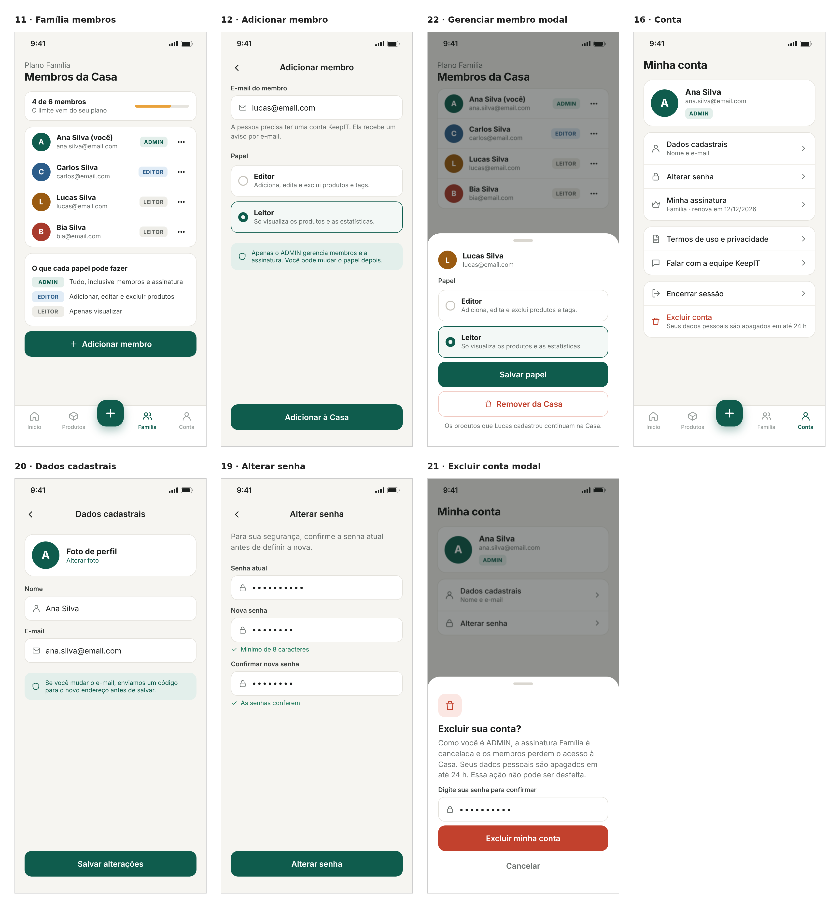
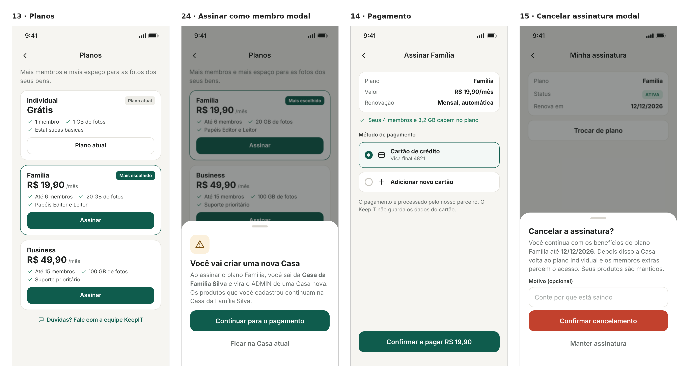
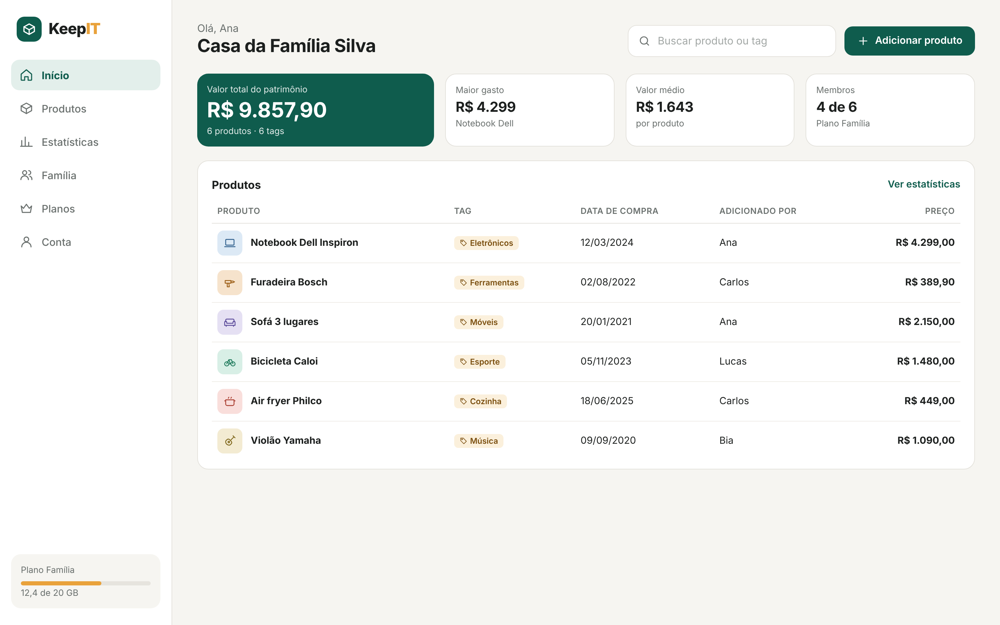

## 1.3 Prototipação

O protótipo de alta fidelidade aplica a identidade visual do KeepIT sobre a estrutura validada nos wireframes. Ele substitui o protótipo feito anteriormente no Stitch e foi construído no Figma com 24 telas: 23 no formato celular (390 × 844 px) e uma no formato desktop (1440 × 900 px), que demonstra o comportamento responsivo do MVP. As telas usam dados de exemplo de uma Casa fictícia, a "Casa da Família Silva", com quatro membros e seis produtos, para mostrar o app em uso real.

Link do protótipo no Figma: https://www.figma.com/design/jnyTTGlOnUnyn9NVKCa7Xr

As Figuras 4 a 8 apresentam as telas agrupadas por fluxo.

**Figura 4: Protótipo — fluxo de acesso**

Fonte: Autoria própria apoiado por IA generativa (Claude, Anthropic), 2026.

**Figura 5: Protótipo — fluxo de produtos**

Fonte: Autoria própria apoiado por IA generativa (Claude, Anthropic), 2026.

**Figura 6: Protótipo — família e conta**

Fonte: Autoria própria apoiado por IA generativa (Claude, Anthropic), 2026.

**Figura 7: Protótipo — planos e assinatura**

Fonte: Autoria própria apoiado por IA generativa (Claude, Anthropic), 2026.

**Figura 8: Protótipo — tela inicial no desktop**

Fonte: Autoria própria apoiado por IA generativa (Claude, Anthropic), 2026.

Cada grupo de telas cobre um conjunto de casos de uso:

(i) **Acesso (Figura 4):** Boas-vindas, Entrar, Criar conta e a recuperação de senha em duas etapas, com código de 6 dígitos válido por 15 minutos e definição da nova senha. A tela de cadastro mostra a validação da senha em tempo real (UC001 a UC009).

(ii) **Produtos (Figura 5):** Início com o resumo da Casa, lista de produtos com busca e filtro por tag, detalhe do produto, cadastro com foto e tags, o aviso de produto duplicado com as três opções previstas na regra de negócio, a confirmação de exclusão e as Estatísticas (UC016, UC017 e UC020 a UC027).

(iii) **Família e conta (Figura 6):** lista de membros com o limite do plano, adição de membro com escolha de papel, o modal para mudar o papel ou remover um membro, e as telas de conta: dados cadastrais, alteração de senha e exclusão de conta com confirmação por senha (UC010 a UC015 e UC033 a UC037).

(iv) **Planos e assinatura (Figura 7):** comparação dos planos, o aviso exibido quando um EDITOR ou LEITOR assina e passa a ter uma Casa própria, o pagamento e o cancelamento da assinatura, que mantém os benefícios até a data de renovação (UC019 e UC028 a UC031).

(v) **Desktop (Figura 8):** a mesma tela de Início reorganizada para tela larga, com menu lateral, indicadores lado a lado e tabela de produtos. O MVP é uma aplicação web responsiva, então todas as telas se adaptam do celular ao desktop dessa forma.

A Tabela 3 resume a identidade visual aplicada ao protótipo.

**Tabela 3: Identidade visual do protótipo**

| Elemento | Definição | Uso |
|---|---|---|
| Cor primária | Verde #0F5C4D | Botões principais, navegação ativa, destaque do valor total |
| Cor de apoio | Âmbar #E9A23B | Tags dos produtos, barra de armazenamento, avisos |
| Fundo | Off-white #F6F5F1 | Fundo das telas |
| Texto | Grafite #1C1F1E e cinza #6B716F | Títulos e textos secundários |
| Erro e exclusão | Vermelho #C2412D | Ações destrutivas e mensagens de erro |
| Papéis | Verde (ADMIN), azul (EDITOR), cinza (LEITOR) | Selos de papel nos membros |
| Tipografia | Inter (400 a 800) | Todos os textos |
| Componentes | Cantos arredondados (12 a 18 px), cartões com borda clara, modais que sobem da parte de baixo | Padrão em todas as telas |

Fonte: Autoria própria apoiado por IA generativa (Claude, Anthropic), 2026.

O protótipo foi conferido contra os 37 casos de uso do sistema. Todos têm pelo menos uma tela correspondente, e as seis telas que faltavam (nova senha, alterar senha, dados cadastrais, excluir conta, gerenciar membro e excluir produto) foram criadas nessa conferência. O protótipo passa a ser a referência visual para a implementação do front-end em React e TypeScript, e as cores e componentes da Tabela 3 serão reaproveitados diretamente no código.
