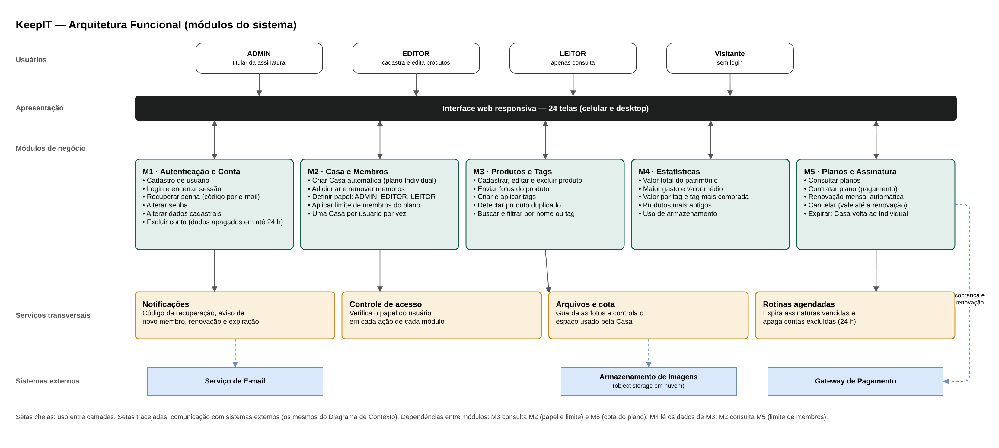

# 2. Arquitetura de Software

## 2.1 Arquitetura Funcional

A arquitetura funcional divide o KeepIT em módulos de acordo com o que cada parte do sistema faz, sem depender da tecnologia usada para implementá-la. Cada módulo agrupa funções relacionadas, atende a um conjunto de telas e casos de uso e tem regras de negócio próprias. Essa divisão orienta a organização do código, a distribuição das tarefas entre os integrantes e a escrita das especificações usadas no desenvolvimento. A Figura 9 apresenta os módulos e como eles se relacionam.

**Figura 9: Arquitetura funcional do KeepIT**

Fonte: Autoria própria apoiado por IA generativa (Claude, Anthropic), 2026.

A arquitetura se organiza em quatro camadas:

(i) **Usuários:** visitantes, que ainda não fizeram login, e membros de uma Casa com um dos três papéis. O ADMIN é o titular da assinatura e gerencia membros e plano. O EDITOR cadastra, edita e exclui produtos e tags. O LEITOR apenas consulta.

(ii) **Apresentação:** a interface web responsiva, com as 24 telas do protótipo, é o único ponto de contato do usuário com o sistema. Ela não guarda regras de negócio; apenas envia as ações para os módulos e exibe o resultado.

(iii) **Módulos de negócio:**
- **M1 · Autenticação e Conta:** cuida da identidade do usuário: cadastro, login, encerramento de sessão, recuperação de senha por código enviado ao e-mail, alteração de senha e de dados cadastrais e exclusão da conta, com os dados pessoais apagados em até 24 horas.
- **M2 · Casa e Membros:** cria automaticamente uma Casa com o plano Individual para cada novo usuário, controla a entrada e saída de membros e o papel de cada um e aplica o limite de membros do plano. Cada usuário participa de uma Casa por vez.
- **M3 · Produtos e Tags:** é o núcleo do inventário: cadastro, edição e exclusão de produtos, envio de fotos, criação e aplicação de tags, busca e filtro. Também aplica a regra de duplicidade: um produto com o mesmo nome na mesma Casa gera o aviso com as opções de somar à quantidade, cadastrar mesmo assim ou cancelar.
- **M4 · Estatísticas:** calcula, a partir dos produtos da Casa, o valor total do patrimônio, o maior gasto, o valor médio, o valor por tag, a tag mais comprada, os produtos mais antigos e o uso de armazenamento.
- **M5 · Planos e Assinatura:** apresenta os planos, contrata um plano por meio do gateway de pagamento, controla a renovação mensal e o cancelamento e trata a expiração. Uma assinatura cancelada mantém os benefícios até a data de renovação; quando expira, a Casa volta ao plano Individual, os membros extras são desvinculados e os produtos são mantidos.

(iv) **Serviços transversais e sistemas externos:** quatro serviços são usados por vários módulos. O Controle de acesso verifica o papel do usuário antes de cada ação. As Notificações enviam e-mails pelo serviço externo de e-mail. Arquivos e cota guarda as fotos no armazenamento em nuvem e controla o espaço usado pela Casa. As Rotinas agendadas expiram assinaturas vencidas e apagam as contas excluídas. Os sistemas externos são os mesmos do Diagrama de Contexto: serviço de e-mail, armazenamento de imagens e gateway de pagamento.

Os módulos também dependem uns dos outros. O M3 consulta o M2 para saber o papel do usuário e o M5 para conferir a cota de armazenamento do plano. O M2 consulta o M5 para saber o limite de membros. O M4 apenas lê os dados do M3. Essas dependências definem a ordem de construção do sistema: primeiro M1, depois M2 e M5, em seguida M3 e, por fim, M4.

A Tabela 4 relaciona cada módulo às telas e aos casos de uso que ele atende.

**Tabela 4: Módulos, telas e casos de uso**

| Módulo | Responsabilidade | Telas | Casos de uso | Papéis com acesso |
|---|---|---|---|---|
| M1 · Autenticação e Conta | Identidade e dados do usuário | 01, 02, 03, 04, 16, 18, 19, 20, 21 | UC001 a UC015 | Visitante e todos os papéis |
| M2 · Casa e Membros | Casa, membros e papéis | 11, 12, 22 | UC018, UC033 a UC037 | Consulta: todos; gestão: ADMIN |
| M3 · Produtos e Tags | Inventário da Casa | 05, 06, 07, 08, 09, 17, 23 | UC016, UC020 a UC026 | Consulta: todos; edição: ADMIN e EDITOR |
| M4 · Estatísticas | Indicadores do patrimônio | 05, 10, 17 | UC017, UC027 | Todos os papéis |
| M5 · Planos e Assinatura | Planos, pagamento e ciclo da assinatura | 13, 14, 15, 24 | UC019, UC028 a UC032 | Planos: todos; assinatura atual: ADMIN |

Fonte: Autoria própria apoiado por IA generativa (Claude, Anthropic), 2026.

Com essa divisão, cada módulo pode ser especificado, construído e testado de forma independente, desde que respeite as dependências descritas. Na próxima seção, a Arquitetura Técnica mostra com quais tecnologias esses módulos são implementados.
