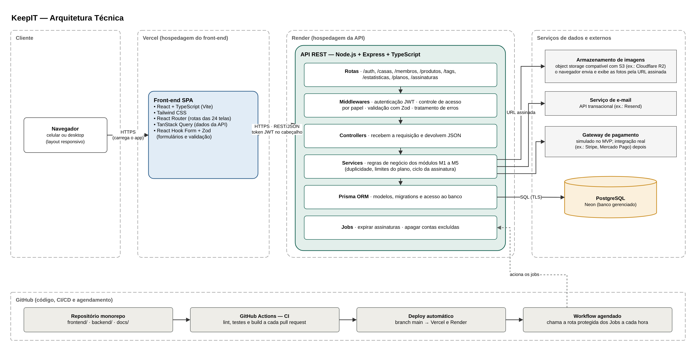

## 2.2 Arquitetura Técnica

A arquitetura técnica define as tecnologias que implementam os módulos da arquitetura funcional e onde cada parte do sistema é executada. As escolhas seguem três critérios: usar a stack definida pelo grupo (React com TypeScript, Node.js e banco relacional), priorizar ferramentas com documentação ampla e boa compatibilidade com assistentes de IA, e hospedar o MVP em serviços com plano gratuito. A Figura 10 apresenta a arquitetura técnica.

**Figura 10: Arquitetura técnica do KeepIT**

Fonte: Autoria própria apoiado por IA generativa (Claude, Anthropic), 2026.

A arquitetura é composta pelos seguintes elementos:

(i) **Cliente:** o usuário acessa o KeepIT pelo navegador do celular ou do computador. Não há instalação; o layout se adapta ao tamanho da tela.

(ii) **Front-end:** uma aplicação de página única (SPA) em React com TypeScript, criada com Vite e estilizada com Tailwind CSS. O React Router organiza as rotas das 24 telas, o TanStack Query faz as chamadas à API e mantém os dados em cache, e o React Hook Form com Zod valida os formulários antes do envio. O front-end é hospedado na Vercel.

(iii) **API:** uma API REST em Node.js com Express e TypeScript, hospedada no Render. Ela é organizada em camadas: as rotas recebem as requisições; os middlewares verificam o token de autenticação (JWT), conferem se o papel do usuário permite a ação e validam os dados com Zod; os controllers tratam a requisição; os services concentram as regras de negócio dos módulos M1 a M5; e o Prisma ORM faz o acesso ao banco. Uma camada de jobs executa as rotinas agendadas.

(iv) **Banco de dados:** PostgreSQL, um banco relacional, hospedado no Neon. O Prisma gera o banco a partir do modelo de dados e controla as alterações por meio de migrations versionadas no repositório.

(v) **Armazenamento de imagens:** as fotos dos produtos ficam em um object storage compatível com S3, como o Cloudflare R2, e não no banco. A API gera uma URL assinada e temporária, e o navegador envia e exibe a foto diretamente por ela. Isso reduz a carga na API e permite controlar a cota de armazenamento de cada Casa.

(vi) **E-mail e pagamento:** um serviço de e-mail transacional, como o Resend, envia o código de recuperação de senha e os avisos de novo membro, renovação e expiração. No MVP, o pagamento é simulado: a API registra a assinatura como se o pagamento tivesse sido aprovado, mantendo o mesmo fluxo de estados (PENDENTE, ATIVA, CANCELADA, EXPIRADA). A integração com um gateway real, como Stripe ou Mercado Pago, fica para uma versão seguinte.

(vii) **Código, integração e entrega contínuas:** o código fica em um único repositório no GitHub (monorepo), com as pastas `frontend/`, `backend/` e `docs/`. A cada pull request, o GitHub Actions executa lint, testes e build. Quando o código entra na branch principal, a Vercel e o Render publicam a nova versão automaticamente. Um workflow agendado do GitHub Actions chama, a cada hora, uma rota protegida da API que executa os jobs de expirar assinaturas vencidas e apagar contas excluídas há mais de 24 horas.

(viii) **Segurança:** toda a comunicação usa HTTPS. As senhas são guardadas apenas como hash (bcrypt), os tokens JWT têm prazo de validade, as permissões são conferidas na API (e não só escondidas na interface) e as chaves dos serviços externos ficam em variáveis de ambiente, fora do código.

A Tabela 5 resume as tecnologias escolhidas e o motivo de cada escolha.

**Tabela 5: Tecnologias da arquitetura técnica**

| Camada | Tecnologia | Motivo da escolha |
|---|---|---|
| Front-end | React + TypeScript (Vite) | Stack definida pelo grupo; tipagem reduz erros e ajuda a IA a gerar código correto |
| Estilo | Tailwind CSS | Aplica as cores e espaçamentos do protótipo direto nas classes |
| Dados no front-end | TanStack Query | Cache e atualização automática dos dados da API |
| Formulários | React Hook Form + Zod | Validação igual no front-end e na API, com o mesmo esquema |
| API | Node.js + Express + TypeScript | Mesma linguagem do front-end; Express é simples e muito documentado |
| Acesso ao banco | Prisma ORM | Modelo de dados legível, migrations versionadas e consultas tipadas |
| Banco de dados | PostgreSQL (Neon) | Banco relacional definido pelo grupo; plano gratuito gerenciado |
| Fotos | Object storage S3 (ex.: Cloudflare R2) | Barato para arquivos grandes; URLs assinadas; controle de cota |
| E-mail | API transacional (ex.: Resend) | Envio simples por API, com plano gratuito |
| Pagamento | Simulado no MVP | Permite testar o ciclo da assinatura sem cobrança real |
| Autenticação | JWT + bcrypt | Padrão para APIs REST; senha nunca guardada em texto puro |
| Hospedagem | Vercel (front-end) e Render (API) | Deploy automático a partir do GitHub, com plano gratuito |
| CI/CD e jobs | GitHub Actions | Testes a cada pull request e agendamento das rotinas sem custo |

Fonte: Autoria própria apoiado por IA generativa (Claude, Anthropic), 2026.

Essa arquitetura atende ao MVP sem custo de infraestrutura. A principal limitação é que o plano gratuito do Render suspende a API depois de um período sem uso, o que deixa a primeira requisição alguns segundos mais lenta. Para um lançamento real, basta migrar para um plano pago, sem mudar o código. A próxima seção detalha como o código da API e do front-end se organiza segundo o padrão MVC.
