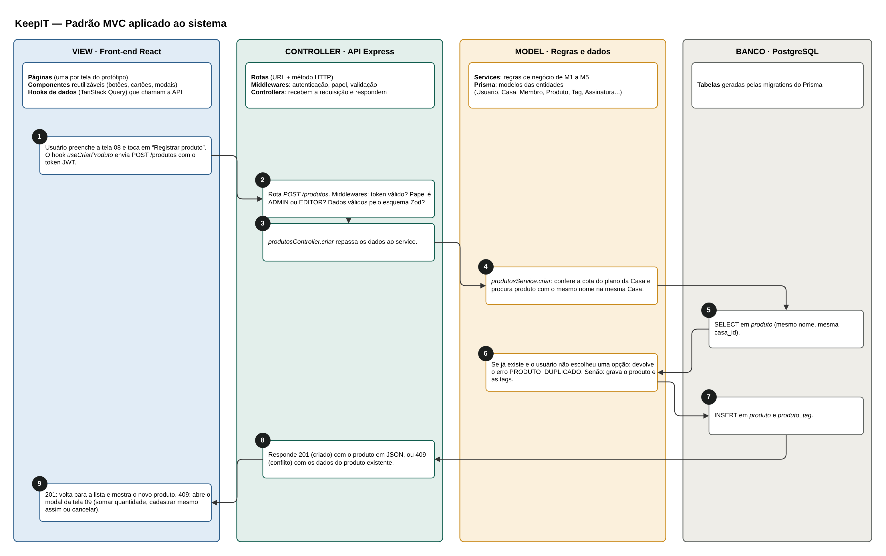

## 2.3 MVC

O KeepIT segue o padrão MVC (Model-View-Controller), que separa o sistema em três responsabilidades: a View mostra as informações e recebe as ações do usuário; o Controller recebe cada requisição e decide o que fazer com ela; e o Model guarda as regras de negócio e os dados. Na arquitetura técnica, a View é o front-end em React, e o Controller e o Model ficam na API em Node.js. Essa separação permite alterar uma tela sem mexer nas regras de negócio e testar as regras sem depender da interface. A Figura 11 mostra as camadas e um exemplo de fluxo completo: o cadastro de um produto, incluindo a regra de duplicidade.

**Figura 11: Padrão MVC no KeepIT, com o fluxo de cadastro de produto**



Fonte: Autoria própria apoiado por IA generativa (Claude, Anthropic), 2026.

Cada camada tem uma função definida:

(i) **View (front-end React):** cada tela do protótipo vira uma página, montada com componentes reutilizáveis, como botões, cartões, campos e modais. A View não contém regras de negócio: ela chama a API por meio de hooks de dados (TanStack Query) e mostra o resultado. As permissões também são escondidas na View (um LEITOR não vê o botão Editar), mas a verificação que vale é sempre a da API.

(ii) **Controller (API Express):** as rotas ligam cada URL e método HTTP a um controller. Antes de chegar ao controller, a requisição passa pelos middlewares, que verificam o token de login, conferem se o papel do usuário permite a ação e validam os dados recebidos. O controller apenas repassa os dados ao service e transforma o resultado em uma resposta HTTP com o código adequado (por exemplo, 201 para criado, 403 para sem permissão, 409 para conflito).

(iii) **Model (services e Prisma):** os services concentram as regras de negócio dos módulos M1 a M5, como a regra de duplicidade, os limites de membros e de armazenamento do plano e as mudanças de estado da assinatura. O Prisma define as entidades do sistema, que correspondem ao diagrama de classes, e faz a leitura e a gravação no PostgreSQL.

(iv) **Fluxo de exemplo:** no cadastro de produto, a tela 08 envia os dados (passo 1); a API confere login, papel e dados (passo 2); o controller chama o service (passo 3); o service confere a cota e procura um produto com o mesmo nome na Casa (passos 4 e 5). Se encontrar, devolve um erro de conflito; se não, grava o produto e as tags (passos 6 e 7). O controller responde à View (passo 8), que mostra o produto novo ou abre o modal de produto duplicado, a tela 09 (passo 9).

O código é organizado por módulo dentro de cada camada, como mostra a Figura 12. Assim, cada integrante pode trabalhar no seu módulo, do front-end ao banco, com pouco conflito com o trabalho dos outros.

**Figura 12: Estrutura de pastas do repositório**

```
keepit/
├── frontend/                     ← VIEW
│   └── src/
│       ├── pages/                  uma página por tela (Inicio, Produtos, ProdutoDetalhe…)
│       ├── components/             componentes reutilizáveis (Button, Card, Modal, TabBar…)
│       ├── features/               código de cada módulo
│       │   ├── auth/                 M1 · telas, hooks e chamadas de autenticação e conta
│       │   ├── casa/                 M2 · membros e papéis
│       │   ├── produtos/             M3 · produtos, fotos e tags
│       │   ├── estatisticas/         M4
│       │   └── assinatura/           M5 · planos e pagamento
│       ├── lib/                    cliente da API, formatação de moeda e datas
│       └── routes.tsx              rotas das 24 telas
├── backend/                      ← CONTROLLER + MODEL
│   ├── prisma/
│   │   ├── schema.prisma           MODEL · entidades (Usuario, Casa, Membro, Produto…)
│   │   └── migrations/
│   └── src/
│       ├── modules/                um diretório por módulo (auth, casa, produtos, estatisticas, assinatura)
│       │   └── produtos/
│       │       ├── produtos.routes.ts       CONTROLLER · rotas e middlewares
│       │       ├── produtos.controller.ts   CONTROLLER · requisição → resposta
│       │       ├── produtos.service.ts      MODEL · regras de negócio
│       │       ├── produtos.schema.ts       validação (Zod)
│       │       └── produtos.test.ts         testes do módulo
│       ├── middlewares/            autenticação, papel, erros
│       ├── jobs/                   expirar assinaturas, apagar contas
│       └── server.ts
└── docs/                         documentação e especificações (lidas pela IA)
```

Fonte: Autoria própria apoiado por IA generativa (Claude, Anthropic), 2026.

A Tabela 6 resume onde cada parte do MVC fica no código.

**Tabela 6: Camadas do MVC no código do KeepIT**

| Camada | Onde fica | Pastas | Responsabilidade | Não deve |
|---|---|---|---|---|
| View | Front-end | `frontend/src/pages`, `components`, `features` | Exibir dados, receber ações, chamar a API | Conter regras de negócio ou acessar o banco |
| Controller | API | `backend/src/modules/*/…routes.ts`, `…controller.ts`, `middlewares/` | Autenticar, autorizar, validar e responder | Calcular regras ou montar consultas ao banco |
| Model | API | `backend/src/modules/*/…service.ts`, `prisma/schema.prisma` | Regras de negócio e acesso aos dados | Saber de HTTP ou de telas |

Fonte: Autoria própria apoiado por IA generativa (Claude, Anthropic), 2026.

Com as camadas e as pastas definidas, a IA usada no desenvolvimento recebe um padrão claro a seguir: cada pedido de código indica o módulo e a camada, e o resultado pode ser revisado comparando com a Tabela 6. Isso fecha a seção de Arquitetura de Software; a próxima seção trata da Engenharia de Requisitos.
