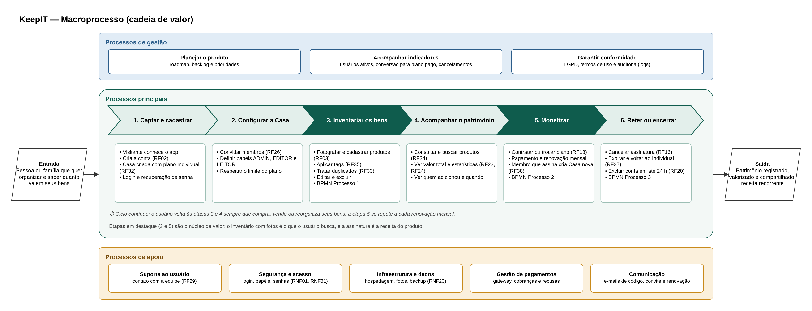

# 4. Processos e Fluxos

## 4.1 Macroprocesso

O macroprocesso mostra a visão geral de como o KeepIT gera valor, do primeiro contato do usuário até o encerramento do relacionamento. Ele é apresentado como uma cadeia de valor, com três níveis: os processos de gestão, que orientam o produto; os processos principais, que entregam valor ao usuário; e os processos de apoio, que dão sustentação aos demais. A Figura 13 apresenta o macroprocesso.

**Figura 13: Macroprocesso do KeepIT**

Fonte: Autoria própria apoiado por IA generativa (Claude, Anthropic), 2026.

O macroprocesso se organiza da seguinte forma:

(i) **Entrada e saída:** a entrada é uma pessoa ou família que quer organizar seus bens e saber quanto eles valem. A saída é o patrimônio registrado, com fotos e valores, compartilhado entre os membros da Casa, e, para o negócio, a receita recorrente das assinaturas.

(ii) **Processos principais:** seis etapas em sequência. Em Captar e cadastrar, o visitante cria a conta e recebe uma Casa com o plano Individual. Em Configurar a Casa, o ADMIN convida membros e define os papéis. Em Inventariar os bens, os membros fotografam, cadastram e categorizam os produtos. Em Acompanhar o patrimônio, consultam os produtos, o valor total e as estatísticas. Em Monetizar, a Casa contrata ou troca de plano para ter mais membros e espaço. Em Reter ou encerrar, o sistema trata cancelamentos, expirações e exclusões de conta.

(iii) **Núcleo de valor:** as etapas 3 (Inventariar) e 5 (Monetizar) estão em destaque. O inventário com fotos é o motivo de o usuário usar o KeepIT, e a assinatura é a fonte de receita do produto. Por isso, são essas as etapas detalhadas nos processos BPMN 1 e 2.

(iv) **Ciclo contínuo:** a cadeia não é percorrida uma única vez. O usuário volta às etapas 3 e 4 sempre que compra, vende ou reorganiza seus bens, e a etapa 5 se repete a cada renovação mensal da assinatura.

(v) **Processos de gestão e apoio:** a gestão planeja o produto, acompanha indicadores (usuários ativos, conversão para planos pagos e cancelamentos) e garante a conformidade com a LGPD. O apoio reúne o suporte ao usuário, a segurança e o controle de acesso, a infraestrutura e os dados, a gestão de pagamentos e a comunicação por e-mail. Esses processos de apoio correspondem aos serviços transversais da arquitetura funcional.

A Tabela 11 relaciona cada etapa principal aos módulos, telas e processos detalhados.

**Tabela 11: Etapas do macroprocesso e sua implementação**

| Etapa | Módulo | Telas | Requisitos principais | Detalhamento |
|---|---|---|---|---|
| 1. Captar e cadastrar | M1 | 01, 02, 03, 04, 18 | RF01, RF02, RF17, RF32 | Casos de uso UC001 a UC009 |
| 2. Configurar a Casa | M2 | 11, 12, 22 | RF25 a RF28 | Casos de uso UC033 a UC037 |
| 3. Inventariar os bens | M3 | 06, 07, 08, 09, 23 | RF03 a RF09, RF33, RF35, RF39 | BPMN Processo 1 |
| 4. Acompanhar o patrimônio | M3 e M4 | 05, 06, 10, 17 | RF10, RF11, RF23, RF24, RF34 | Diagrama de Fluxo de Dados |
| 5. Monetizar | M5 | 13, 14, 24 | RF12 a RF15, RF38 | BPMN Processo 2 |
| 6. Reter ou encerrar | M1 e M5 | 15, 16, 21 | RF16, RF20, RF37 | BPMN Processo 3 e Máquina de Estados da Assinatura |

Fonte: Autoria própria apoiado por IA generativa (Claude, Anthropic), 2026.

O macroprocesso conecta a visão de negócio com o sistema: cada etapa tem um módulo responsável, telas no protótipo e requisitos definidos. Os processos com mais regras de negócio (cadastro de produto, contratação de plano e cancelamento) são detalhados em BPMN na próxima seção.
