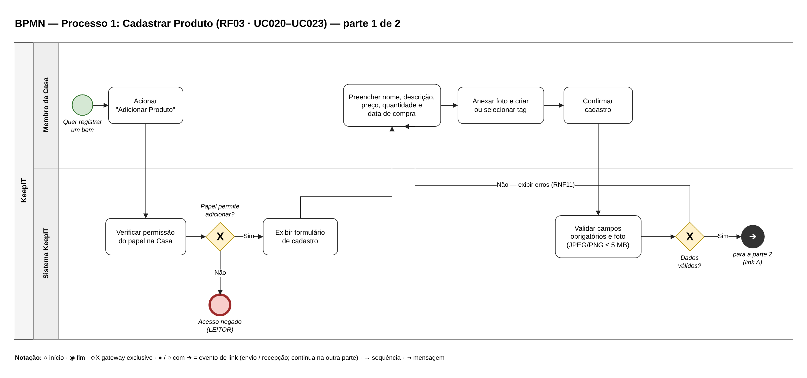
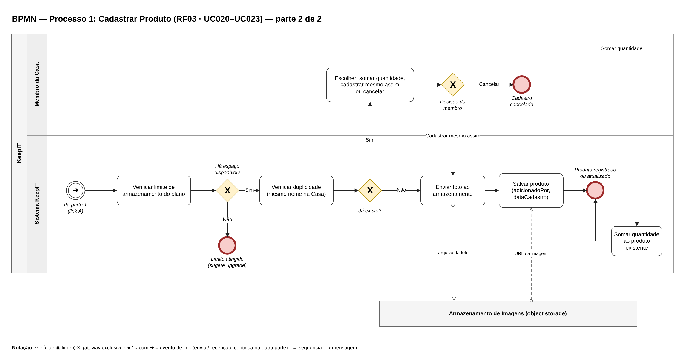
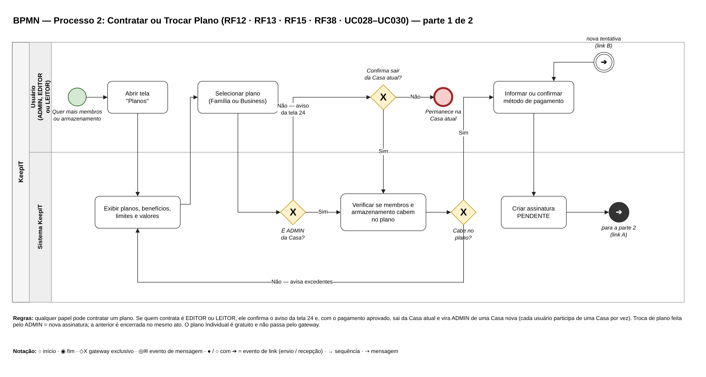
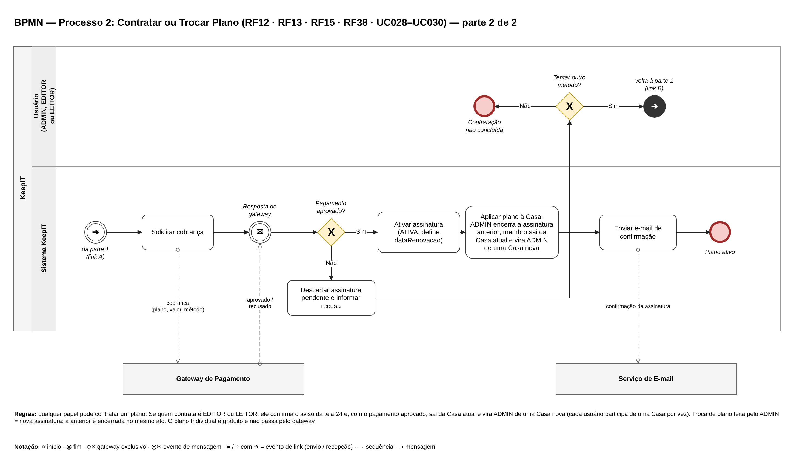
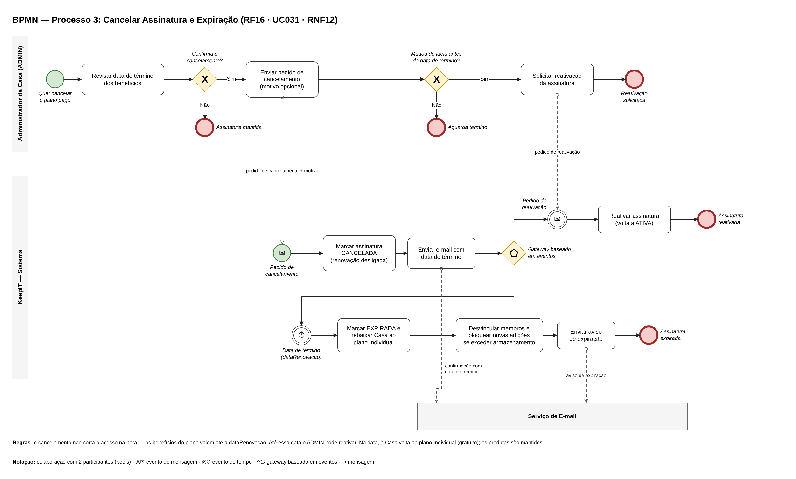

## 4.2 BPMN

Os três processos de negócio com mais regras foram modelados em BPMN (Business Process Model and Notation): o cadastro de produto, a contratação ou troca de plano e o cancelamento da assinatura. Cada diagrama mostra quem executa cada tarefa (o usuário ou o sistema), as decisões do processo e a comunicação com os sistemas externos. Para manter a legibilidade, os processos mais longos foram divididos em duas partes, ligadas por eventos de link.

Esses diagramas foram feitos na entrega anterior de Modelagem de Sistemas. Nesta revisão, o Processo 2 foi atualizado para refletir a decisão de que qualquer papel pode contratar um plano: quando o usuário não é ADMIN, ele confirma o aviso de que sairá da Casa atual e, com o pagamento aprovado, passa a ser o ADMIN de uma Casa nova. Os Processos 1 e 3 continuam válidos sem alterações.

**Figura 14: BPMN — Processo 1, Cadastrar Produto (parte 1 de 2)**

Fonte: Autoria própria apoiado por IA generativa (Claude, Anthropic), 2026.

**Figura 15: BPMN — Processo 1, Cadastrar Produto (parte 2 de 2)**

Fonte: Autoria própria apoiado por IA generativa (Claude, Anthropic), 2026.

**Figura 16: BPMN — Processo 2, Contratar ou Trocar Plano (parte 1 de 2)**

Fonte: Autoria própria apoiado por IA generativa (Claude, Anthropic), 2026.

**Figura 17: BPMN — Processo 2, Contratar ou Trocar Plano (parte 2 de 2)**

Fonte: Autoria própria apoiado por IA generativa (Claude, Anthropic), 2026.

**Figura 18: BPMN — Processo 3, Cancelar Assinatura**

Fonte: Autoria própria apoiado por IA generativa (Claude, Anthropic), 2026.

Os processos se descrevem assim:

(i) **Processo 1, Cadastrar Produto:** o membro aciona "Adicionar produto", e o sistema verifica se o papel permite a ação (o LEITOR é bloqueado). O membro preenche os dados, anexa a foto e escolhe as tags. O sistema valida os campos e o formato da foto (JPEG ou PNG, até 5 MB), confere se a Casa ainda tem espaço de armazenamento no plano e verifica se já existe um produto com o mesmo nome na Casa. Nesse caso, o membro escolhe entre somar à quantidade, cadastrar mesmo assim ou cancelar. Por fim, a foto é enviada ao armazenamento de imagens e o produto é gravado.

(ii) **Processo 2, Contratar ou Trocar Plano:** o usuário abre os planos e escolhe o Família ou o Business. Se ele não for ADMIN da Casa, o sistema mostra o aviso da tela 24, e o usuário decide se continua. Em seguida, o sistema verifica se os membros e o armazenamento atuais cabem no plano escolhido, o usuário informa o método de pagamento e o sistema cria a assinatura como PENDENTE e solicita a cobrança ao gateway. Se o pagamento for aprovado, a assinatura passa a ATIVA, o plano é aplicado à Casa (encerrando a assinatura anterior ou, no caso de um membro, criando a Casa nova) e o sistema envia o e-mail de confirmação. Se for recusado, o usuário pode tentar outro método.

(iii) **Processo 3, Cancelar Assinatura:** o ADMIN pede o cancelamento e confirma no modal. O sistema muda a assinatura para CANCELADA e desliga a renovação, mas mantém os benefícios até a data de renovação. Quando essa data chega, a rotina agendada muda a assinatura para EXPIRADA, devolve a Casa ao plano Individual, desvincula os membros extras e mantém os produtos. Se o ADMIN reativar a assinatura antes dessa data, ela volta a ATIVA.

A Tabela 12 resume os três processos.

**Tabela 12: Processos modelados em BPMN**

| Processo | Participantes | Sistemas externos | Requisitos | Casos de uso | Telas |
|---|---|---|---|---|---|
| 1. Cadastrar Produto | Membro da Casa (ADMIN ou EDITOR), Sistema | Armazenamento de imagens | RF03, RF05, RF08, RF33, RF35, RF39 | UC020 a UC023 | 08, 09 |
| 2. Contratar ou Trocar Plano | Usuário (qualquer papel), Sistema | Gateway de pagamento, Serviço de e-mail | RF12, RF13, RF15, RF38 | UC028 a UC030 | 13, 14, 24 |
| 3. Cancelar Assinatura | ADMIN, Sistema | Gateway de pagamento, Serviço de e-mail | RF16, RF37 | UC031 | 15 |

Fonte: Autoria própria apoiado por IA generativa (Claude, Anthropic), 2026.

Os processos em BPMN detalham as etapas centrais do macroprocesso e são a base dos critérios de aceite das especificações de desenvolvimento: cada decisão (losango) no diagrama corresponde a uma regra que o código precisa implementar e que os testes precisam verificar.
