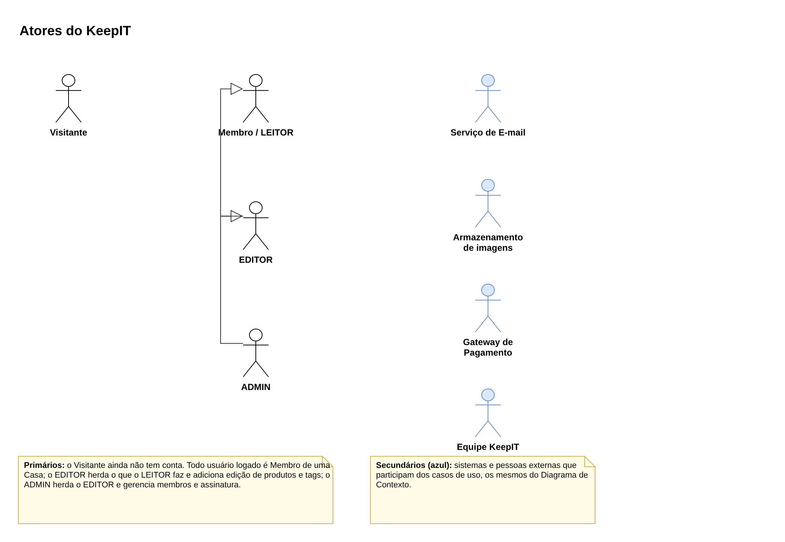
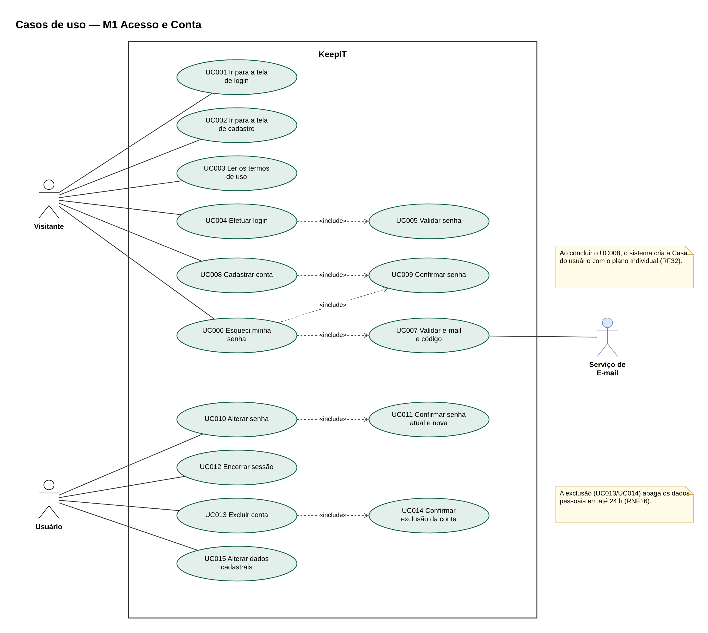
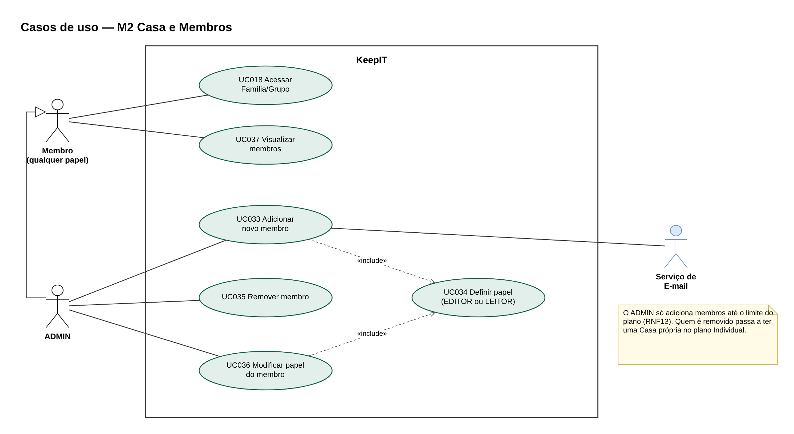
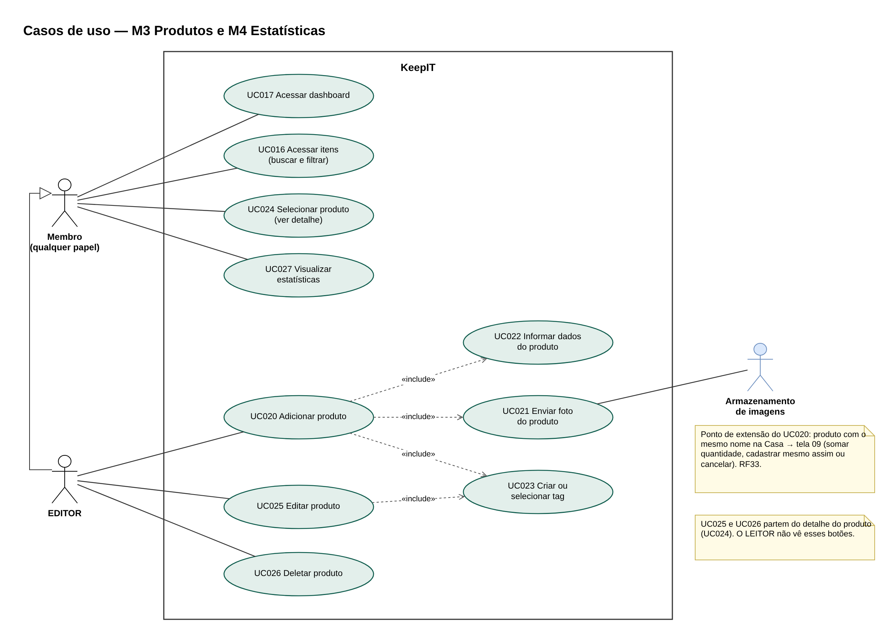
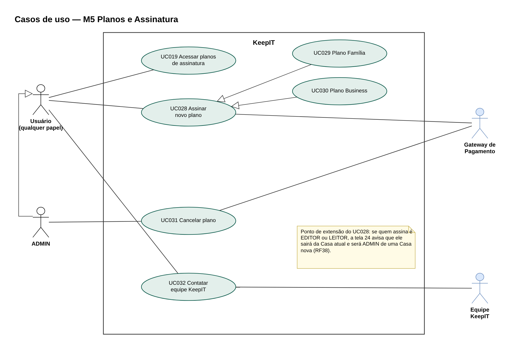

## 5.1 Diagrama de Caso de Uso

O diagrama de caso de uso mostra o que cada tipo de usuário pode fazer no KeepIT e quais sistemas externos participam dessas ações. A primeira versão, com 37 casos de uso (UC001 a UC037), foi feita pelo grupo em nove diagramas separados. Nesta revisão, o conteúdo dos casos de uso foi mantido, mas os diagramas foram refeitos seguindo a notação UML e reorganizados por módulo da arquitetura funcional, e as tabelas foram alinhadas às decisões tomadas na modelagem.

As principais correções foram:

(i) **Atores:** na versão anterior, todos os casos de uso tinham como atores "Usuário KeepIt" e "Sistema KeepIt". Na UML, o sistema não é um ator; ele é o retângulo que delimita os casos de uso. Os atores passaram a refletir os papéis do sistema: o Visitante, que ainda não tem conta; o Membro da Casa, que pode ser LEITOR, EDITOR ou ADMIN; e os atores secundários, que são os sistemas e pessoas externos do Diagrama de Contexto (Serviço de E-mail, Armazenamento de imagens, Gateway de Pagamento e Equipe KeepIT). A Figura 19 mostra os atores e a herança entre os papéis: o EDITOR pode fazer tudo o que o LEITOR faz, e o ADMIN, tudo o que o EDITOR faz.

(ii) **Requisitos e telas:** o campo "Requisitos" passou a indicar os identificadores dos requisitos funcionais (RF) de cada caso de uso, e o campo "Protótipo das telas" passou a apontar para as telas numeradas do protótipo.

(iii) **Conteúdo:** a pré-condição "Ter baixado o APP" foi trocada pelo acesso pelo navegador, já que o MVP é web. Foram retirados o campo "validade" do produto e o "telefone" dos dados cadastrais, e foram incluídas as regras de negócio que faltavam: a Casa criada no cadastro (UC008), o produto duplicado e o limite de armazenamento (UC020), a assinatura feita por um membro que não é ADMIN (UC028), os benefícios mantidos até a renovação após o cancelamento (UC031) e o limite de membros do plano (UC033). O UC018 deixou de prever um usuário sem grupo, porque todo usuário sempre tem uma Casa.

(iv) **UC034:** o caso de uso "Criar ou Selecionar uma Tag (Membro)" foi reescrito como "Definir Papel do Membro", porque os membros são organizados por papel (EDITOR ou LEITOR) e não por tags.

**Figura 19: Atores do KeepIT**

Fonte: Autoria própria apoiado por IA generativa (Claude, Anthropic), 2026.

**Figura 20: Casos de uso do módulo M1, Acesso e Conta**

Fonte: Autoria própria apoiado por IA generativa (Claude, Anthropic), 2026.

**Figura 21: Casos de uso do módulo M2, Casa e Membros**

Fonte: Autoria própria apoiado por IA generativa (Claude, Anthropic), 2026.

**Figura 22: Casos de uso dos módulos M3, Produtos, e M4, Estatísticas**

Fonte: Autoria própria apoiado por IA generativa (Claude, Anthropic), 2026.

**Figura 23: Casos de uso do módulo M5, Planos e Assinatura**

Fonte: Autoria própria apoiado por IA generativa (Claude, Anthropic), 2026.

Os diagramas usam dois tipos de relação entre casos de uso. O «include» indica um passo que sempre faz parte de outro caso de uso, como a validação da senha no login (UC004 inclui UC005). A seta de generalização indica um caso particular de outro, como os planos Família e Business, que são formas de assinar um novo plano (UC029 e UC030 especializam o UC028). Os pontos de extensão, como o aviso de produto duplicado e o aviso de nova Casa, aparecem em notas nos diagramas e como fluxos alternativos nas tabelas.

A seguir estão as tabelas dos 37 casos de uso, na estrutura usada pelo grupo.

**UC001 - Tela de Login**

| Campo | Descrição |
|---|---|
| **Objetivos:** | Ser direcionado para a tela de login |
| **Requisitos:** | RF01, RNF24, RNF29, RNF30 |
| **Atores:** | Visitante |
| **Prioridade:** | Alta |
| **Frequência de uso:** | Raramente(O usuário usará essa tela quando registrar e logar pela primeira vez ou quando encerrar a sessão) |
| **Pré-condições:** | Acessar o KeepIT pelo navegador (celular ou computador). |
| **Pós-condições:** | O Usuário poderá efetuar o login |
| **Campos:** | botão entrar, cadastrar e termos de uso |
| **Fluxo principal:** | a) Usuário clica no botão entrar b) Usuário é direcionado para a tela de login |
| **Fluxo alternativo:** | a) Usuário encerra a sessão b) Na página inicial ele clica no botão entrar c) Usuário é direcionado para a tela de login |
| **Fluxo de exceção:** | Caso não esteja conectado a internet uma mensagem aparecerá na tela informando a falta de conexão |
| **Validações:** | Usuário deve estar conectado a internet |
| **Protótipo das telas:** | 01 Boas-vindas → 02 Entrar |

**UC002 - Tela de Cadastro**

| Campo | Descrição |
|---|---|
| **Objetivos:** | Ser direcionado para a tela de cadastro |
| **Requisitos:** | RF02, RNF24, RNF29, RNF30 |
| **Atores:** | Visitante |
| **Prioridade:** | Alta |
| **Frequência de uso:** | Única(O usuário usará essa tela somente para efetuar o seu cadastro) |
| **Pré-condições:** | Acessar o KeepIT pelo navegador (celular ou computador). |
| **Pós-condições:** | O Usuário poderá efetuar o cadastro |
| **Campos:** | botões: entrar, cadastrar e termos de uso |
| **Fluxo principal:** | a) Usuário clica no botão cadastrar b) Usuário é direcionado para a tela de cadastro |
| **Fluxo de exceção:** | Caso não esteja conectado a internet uma mensagem aparecerá na tela informando a falta de conexão |
| **Validações:** | Usuário deve estar conectado a internet |
| **Protótipo das telas:** | 01 Boas-vindas → 03 Criar conta |

**UC003 - Termos de Uso**

| Campo | Descrição |
|---|---|
| **Objetivos:** | Ler os Termos de Uso |
| **Requisitos:** | RF30, RNF04, RNF24, RNF29, RNF30 |
| **Atores:** | Visitante |
| **Prioridade:** | Baixa |
| **Frequência de uso:** | Raramente(Poucas pessoas realmente leem os termos) |
| **Pré-condições:** | Acessar o KeepIT pelo navegador (celular ou computador). |
| **Pós-condições:** | O usuário terá acesso aos termos de uso |
| **Campos:** | botões: entrar, cadastrar e termos de uso |
| **Fluxo principal:** | a) Usuário clica no botão termos de uso b) Os termos aparecem na mesma página |
| **Fluxo de exceção:** | Caso não esteja conectado a internet uma mensagem aparecerá na tela informando a falta de conexão |
| **Validações:** | Usuário deve estar conectado a internet |
| **Protótipo das telas:** | Link em 01 Boas-vindas, 03 Criar conta e 16 Conta (página de texto) |

**UC004 - Login**

| Campo | Descrição |
|---|---|
| **Objetivos:** | Permitir que o usuário acesse sua conta no KeepIt. |
| **Requisitos:** | RF01 |
| **Atores:** | Visitante |
| **Prioridade:** | Alta |
| **Frequência de uso:** | Frequentemente |
| **Pré-condições:** | Ter uma conta cadastrada e estar na tela de login. |
| **Pós-condições:** | Usuário autenticado e direcionado para a tela inicial. |
| **Campos:** | E-mail, senha e botão Entrar. |
| **Fluxo principal:** | a) Usuário informa e-mail e senha. b) Usuário clica em Entrar. c) Sistema valida os dados e libera o acesso. |
| **Fluxo alternativo:** | a) Usuário seleciona a opção de cadastro ou recuperação de senha. b) Sistema direciona para a tela escolhida. |
| **Fluxo de exceção:** | E-mail ou senha inválidos: sistema exibe uma mensagem de erro e mantém o usuário na tela de login. |
| **Validações:** | E-mail preenchido em formato válido e senha correspondente à conta. |
| **Protótipo das telas:** | 02 Entrar |

**UC005 - Validação de Senha**

| Campo | Descrição |
|---|---|
| **Objetivos:** | Validar a senha informada pelo usuário durante a autenticação. |
| **Requisitos:** | Requisito funcional de validação de credenciais. |
| **Atores:** | Visitante |
| **Prioridade:** | Alta |
| **Frequência de uso:** | Frequentemente |
| **Pré-condições:** | Usuário possuir uma conta e informar uma senha. |
| **Pós-condições:** | Senha validada ou mensagem de erro exibida. |
| **Campos:** | Senha, botão Entrar e mensagem de validação. |
| **Fluxo principal:** | a) Usuário informa a senha. b) Sistema compara a senha com o cadastro. c) Sistema confirma ou recusa a autenticação. |
| **Fluxo alternativo:** | a) Usuário seleciona Esqueci Minha Senha. b) Sistema direciona para a recuperação de acesso. |
| **Fluxo de exceção:** | Senha incorreta: sistema informa que os dados não são válidos. |
| **Validações:** | Senha deve estar preenchida e corresponder à senha cadastrada. |
| **Protótipo das telas:** | 02 Entrar; 03 Criar conta |

**UC006 - Esqueci Minha Senha**

| Campo | Descrição |
|---|---|
| **Objetivos:** | Permitir a recuperação do acesso à conta quando o usuário esquecer a senha. |
| **Requisitos:** | RF17 |
| **Atores:** | Visitante (primário); Serviço de E-mail (secundário) |
| **Prioridade:** | Média |
| **Frequência de uso:** | Raramente |
| **Pré-condições:** | Usuário possuir uma conta cadastrada. |
| **Pós-condições:** | Usuário autorizado a redefinir sua senha. |
| **Campos:** | E-mail, botão Recuperar e código de validação. |
| **Fluxo principal:** | a) Usuário seleciona Esqueci Minha Senha. b) Informa o e-mail cadastrado. c) Sistema inicia o processo de recuperação. |
| **Fluxo alternativo:** | a) Usuário retorna para o Login. b) Sistema cancela a recuperação sem alterar a conta. |
| **Fluxo de exceção:** | E-mail não cadastrado: sistema informa que não encontrou uma conta correspondente. |
| **Validações:** | E-mail deve estar preenchido e possuir formato válido. |
| **Protótipo das telas:** | 02 Entrar (link) → 04 Recuperar senha |

**UC007 - Validação de Email e Código**

| Campo | Descrição |
|---|---|
| **Objetivos:** | Confirmar a identidade do usuário por meio do e-mail e código de recuperação. |
| **Requisitos:** | RF17 |
| **Atores:** | Visitante (primário); Serviço de E-mail (secundário) |
| **Prioridade:** | Alta |
| **Frequência de uso:** | Raramente |
| **Pré-condições:** | Usuário ter solicitado a recuperação e recebido um código. |
| **Pós-condições:** | Código validado e acesso à etapa de definição da nova senha. |
| **Campos:** | E-mail, código de validação e botão Confirmar. |
| **Fluxo principal:** | a) Usuário informa o código recebido. b) Sistema valida o código. c) Sistema libera a alteração da senha. |
| **Fluxo alternativo:** | a) Usuário solicita um novo código. b) Sistema gera e envia um novo código. |
| **Fluxo de exceção:** | Código inválido ou expirado: sistema informa o erro e solicita novo código. |
| **Validações:** | Código deve corresponder ao enviado e estar dentro do prazo de validade. O código tem 6 dígitos e vale por 15 minutos. |
| **Protótipo das telas:** | 04 Recuperar senha (código) |

**UC008 - Cadastrar conta**

| Campo | Descrição |
|---|---|
| **Objetivos:** | Criar uma nova conta de usuário no sistema. |
| **Requisitos:** | RF02, RF32 |
| **Atores:** | Visitante |
| **Prioridade:** | Alta |
| **Frequência de uso:** | Raramente (uma vez por usuário) |
| **Pré-condições:** | Não ter cadastro no sistema. |
| **Pós-condições:** | Conta criada e salva no banco de dados. O sistema cria uma Casa para o usuário com o plano Individual, e ele passa a ser o ADMIN dessa Casa. |
| **Campos:** | Nome, E-mail, Senha e Confirmar Senha. |
| **Fluxo principal:** | a) Acessar a tela de cadastro. b) Preencher os campos. c) Clicar em Cadastrar. d) Sistema valida os dados e confirma a criação. |
| **Fluxo alternativo:** | a) Usuário clica em Voltar. b) Sistema retorna para Login sem salvar os dados. |
| **Fluxo de exceção:** | E-mail já cadastrado, campo obrigatório vazio ou senhas divergentes: sistema exibe mensagem de erro e não conclui o cadastro. |
| **Validações:** | Todos os campos obrigatórios preenchidos, e-mail válido e senha igual à confirmação. Senha com no mínimo 8 caracteres. |
| **Protótipo das telas:** | 03 Criar conta |

**UC009 - Confirmação de Senha**

| Campo | Descrição |
|---|---|
| **Objetivos:** | Confirmar a nova senha antes de concluir sua alteração. |
| **Requisitos:** | RF17 |
| **Atores:** | Visitante |
| **Prioridade:** | Alta |
| **Frequência de uso:** | Raramente |
| **Pré-condições:** | Usuário estar criando a conta (tela 03) ou definindo uma nova senha na recuperação de acesso (tela 18). |
| **Pós-condições:** | Nova senha confirmada e pronta para ser salva. |
| **Campos:** | Nova senha, Confirmar Senha e botão Confirmar. |
| **Fluxo principal:** | a) Usuário informa a nova senha. b) Repete a senha no campo de confirmação. c) Sistema compara os dois campos. |
| **Fluxo alternativo:** | a) Usuário corrige os campos. b) Sistema realiza nova validação. |
| **Fluxo de exceção:** | Senhas diferentes: sistema exibe mensagem de erro. |
| **Validações:** | Os campos devem estar preenchidos e possuir o mesmo valor. |
| **Protótipo das telas:** | 18 Nova senha; 03 Criar conta |

**UC010 - Alterar Senha**

| Campo | Descrição |
|---|---|
| **Objetivos:** | Alterar a senha de acesso do usuário. |
| **Requisitos:** | RF31 |
| **Atores:** | Usuário (qualquer papel) |
| **Prioridade:** | Média |
| **Frequência de uso:** | Raramente |
| **Pré-condições:** | Usuário estar logado. |
| **Pós-condições:** | Senha alterada e salva no sistema. |
| **Campos:** | Senha atual, nova senha, confirmar nova senha e botão Alterar. |
| **Fluxo principal:** | a) Usuário acessa a Conta. b) Seleciona Alterar Senha. c) Informa a senha atual e a nova senha. d) Confirma a alteração. |
| **Fluxo alternativo:** | a) Usuário cancela a operação. b) Sistema retorna à Conta sem alterar a senha. |
| **Fluxo de exceção:** | Senha atual incorreta ou novas senhas diferentes: sistema informa o erro. |
| **Validações:** | Senha atual deve estar correta e nova senha deve ser confirmada. |
| **Protótipo das telas:** | 16 Conta → 19 Alterar senha |

**UC011 - Confirmação de Senha Anterior e Nova**

| Campo | Descrição |
|---|---|
| **Objetivos:** | Confirmar a senha anterior e validar a nova senha durante a alteração. |
| **Requisitos:** | RF31 |
| **Atores:** | Usuário (qualquer papel) |
| **Prioridade:** | Alta |
| **Frequência de uso:** | Raramente |
| **Pré-condições:** | Usuário estar logado e ter solicitado alteração de senha. |
| **Pós-condições:** | Nova senha validada e disponível para atualização. |
| **Campos:** | Senha atual, nova senha, confirmar nova senha e botão Confirmar. |
| **Fluxo principal:** | a) Usuário informa a senha atual. b) Informa e confirma a nova senha. c) Sistema valida os dados. |
| **Fluxo alternativo:** | a) Usuário corrige os dados. b) Sistema realiza nova validação. |
| **Fluxo de exceção:** | Senha atual incorreta ou novas senhas divergentes: sistema exibe mensagem de erro. |
| **Validações:** | Senha atual correta; nova senha e confirmação iguais e preenchidas. |
| **Protótipo das telas:** | 19 Alterar senha |

**UC012 - Encerrar Sessão**

| Campo | Descrição |
|---|---|
| **Objetivos:** | Encerrar a sessão atual do usuário no KeepIt. |
| **Requisitos:** | RF21 |
| **Atores:** | Usuário (qualquer papel) |
| **Prioridade:** | Média |
| **Frequência de uso:** | Raramente |
| **Pré-condições:** | Usuário estar autenticado. |
| **Pós-condições:** | Sessão encerrada e usuário direcionado para a tela de login. |
| **Campos:** | Botão Encerrar Sessão e confirmação. |
| **Fluxo principal:** | a) Usuário acessa a Conta. b) Clica em Encerrar Sessão. c) Sistema encerra a sessão e retorna ao Login. |
| **Fluxo alternativo:** | a) Usuário cancela a confirmação. b) Sistema mantém a sessão ativa. |
| **Fluxo de exceção:** | Falha ao encerrar a sessão: sistema informa o erro e mantém o usuário na tela. |
| **Validações:** | Somente usuário autenticado pode encerrar a própria sessão. |
| **Protótipo das telas:** | 16 Conta |

**UC013 - Excluir Conta**

| Campo | Descrição |
|---|---|
| **Objetivos:** | Permitir que o usuário solicite a exclusão de sua conta. |
| **Requisitos:** | RF20 |
| **Atores:** | Usuário (qualquer papel) |
| **Prioridade:** | Média |
| **Frequência de uso:** | Raramente |
| **Pré-condições:** | Usuário estar logado e acessar as configurações da conta. |
| **Pós-condições:** | Pedido de exclusão confirmado no UC014. Os dados pessoais são apagados em até 24 horas. |
| **Campos:** | Opção Excluir Conta e botão de confirmação. |
| **Fluxo principal:** | a) Usuário acessa a Conta. b) Seleciona Excluir Conta. c) Sistema apresenta a confirmação. |
| **Fluxo alternativo:** | (1) a) Usuário cancela a operação. b) Sistema mantém a conta ativa. (2) Se o usuário for ADMIN de uma Casa com assinatura, o sistema avisa que a assinatura será cancelada e que os demais membros passarão a ter uma Casa própria com o plano Individual. |
| **Fluxo de exceção:** | Falha no processamento: sistema informa que a conta não pôde ser excluída. |
| **Validações:** | Usuário deve estar autenticado e confirmar a exclusão. |
| **Protótipo das telas:** | 16 Conta → 21 Excluir conta |

**UC014 - Confirmação da Exclusão de Conta**

| Campo | Descrição |
|---|---|
| **Objetivos:** | Confirmar a intenção do usuário antes da exclusão da conta. |
| **Requisitos:** | RF20 |
| **Atores:** | Usuário (qualquer papel) |
| **Prioridade:** | Alta |
| **Frequência de uso:** | Raramente |
| **Pré-condições:** | Usuário ter solicitado a exclusão da conta. |
| **Pós-condições:** | Sessão encerrada e conta marcada para exclusão; os dados pessoais são apagados em até 24 horas. |
| **Campos:** | Mensagem de confirmação, senha atual, botão Excluir minha conta e botão Cancelar. |
| **Fluxo principal:** | a) Sistema apresenta a confirmação. b) Usuário confirma. c) Sistema exclui a conta e encerra a sessão. |
| **Fluxo alternativo:** | a) Usuário seleciona Cancelar. b) Sistema retorna à Conta sem excluir a conta. |
| **Fluxo de exceção:** | Erro ao excluir os dados: sistema informa a falha e mantém a conta. |
| **Validações:** | A exclusão somente ocorre após confirmação explícita e com a senha atual correta. |
| **Protótipo das telas:** | 21 Excluir conta (modal) |

**UC015 - Alteração de Dados Cadastrais**

| Campo | Descrição |
|---|---|
| **Objetivos:** | Permitir que o usuário atualize seus dados cadastrais. |
| **Requisitos:** | RF18, RF19 |
| **Atores:** | Usuário (qualquer papel) |
| **Prioridade:** | Média |
| **Frequência de uso:** | Ocasionalmente |
| **Pré-condições:** | Usuário estar logado e possuir cadastro. |
| **Pós-condições:** | Dados cadastrais atualizados no sistema. |
| **Campos:** | Foto de perfil, nome, e-mail e botão Salvar alterações. |
| **Fluxo principal:** | a) Usuário acessa a Conta. b) Edita os dados desejados. c) Clica em Salvar. d) Sistema atualiza o cadastro. |
| **Fluxo alternativo:** | a) Usuário cancela a edição. b) Sistema mantém os dados anteriores. |
| **Fluxo de exceção:** | Dados inválidos ou erro ao salvar: sistema informa o problema e não conclui a alteração. |
| **Validações:** | Campos obrigatórios preenchidos e e-mail em formato válido. A troca de e-mail só é concluída após a confirmação de um código enviado ao novo endereço. |
| **Protótipo das telas:** | 16 Conta → 20 Dados cadastrais |

**UC016 - Acessar Itens**

| Campo | Descrição |
|---|---|
| **Objetivos:** | Permitir visualizar os produtos cadastrados no inventário. |
| **Requisitos:** | RF10, RF34 |
| **Atores:** | Membro da Casa (qualquer papel) |
| **Prioridade:** | Alta |
| **Frequência de uso:** | Frequentemente |
| **Pré-condições:** | Usuário estar logado. |
| **Pós-condições:** | Lista de itens do inventário exibida. |
| **Campos:** | Lista de produtos, busca, filtros e botão Adicionar Produto. |
| **Fluxo principal:** | a) Usuário acessa a área de Itens. b) Sistema busca os produtos cadastrados. c) Sistema exibe a lista. |
| **Fluxo alternativo:** | a) Usuário utiliza busca ou filtro. b) Sistema exibe os itens correspondentes. |
| **Fluxo de exceção:** | Nenhum item cadastrado: sistema exibe mensagem informativa. |
| **Validações:** | Usuário autenticado e itens pertencentes ao inventário acessado. |
| **Protótipo das telas:** | 06 Produtos; 17 Início (desktop) |

**UC017 - Acessar Dashboard**

| Campo | Descrição |
|---|---|
| **Objetivos:** | Apresentar um resumo das informações do inventário. |
| **Requisitos:** | RF11, RF24 |
| **Atores:** | Membro da Casa (qualquer papel) |
| **Prioridade:** | Alta |
| **Frequência de uso:** | Frequentemente |
| **Pré-condições:** | Usuário estar logado. |
| **Pós-condições:** | Dashboard carregado com os principais indicadores. |
| **Campos:** | Valor total do patrimônio, quantidade de produtos, tags e membros, uso de armazenamento, data de renovação da assinatura e últimos produtos adicionados. |
| **Fluxo principal:** | a) Usuário acessa a tela inicial. b) Sistema consulta os dados do inventário. c) Sistema apresenta as informações resumidas. |
| **Fluxo alternativo:** | a) Usuário seleciona outra área do aplicativo. b) Sistema mantém os dados salvos. |
| **Fluxo de exceção:** | Falha ao carregar os dados: sistema exibe mensagem informativa. |
| **Validações:** | Usuário autenticado e dados disponíveis para consulta. |
| **Protótipo das telas:** | 05 Início; 17 Início (desktop) |

**UC018 - Acessar Família/Grupo**

| Campo | Descrição |
|---|---|
| **Objetivos:** | Permitir o acesso ao grupo ou família do usuário. |
| **Requisitos:** | RF25 |
| **Atores:** | Membro da Casa (qualquer papel) |
| **Prioridade:** | Média |
| **Frequência de uso:** | Frequentemente |
| **Pré-condições:** | Usuário estar logado. Todo usuário pertence a uma Casa. |
| **Pós-condições:** | Informações do grupo/família exibidas. |
| **Campos:** | Plano da Casa, limite de membros, lista de membros com o papel de cada um e opções de gerenciamento (apenas para o ADMIN). |
| **Fluxo principal:** | a) Usuário acessa Família/Grupo. b) Sistema identifica o grupo. c) Sistema exibe seus dados e membros. |
| **Fluxo alternativo:** | a) A Casa está no plano Individual. b) O sistema mostra apenas o próprio usuário e indica a assinatura de um plano para adicionar membros. |
| **Fluxo de exceção:** | Grupo indisponível: sistema informa que não foi possível carregar os dados. |
| **Validações:** | Usuário autenticado e com permissão de acesso ao grupo. |
| **Protótipo das telas:** | 11 Família (membros) |

**UC019 - Acessar Planos de Assinatura**

| Campo | Descrição |
|---|---|
| **Objetivos:** | Permitir consultar os planos de assinatura disponíveis no KeepIt. |
| **Requisitos:** | RF12 |
| **Atores:** | Usuário (qualquer papel) |
| **Prioridade:** | Média |
| **Frequência de uso:** | Ocasionalmente |
| **Pré-condições:** | Usuário acessar a área de planos. |
| **Pós-condições:** | Planos disponíveis e respectivas condições exibidos. |
| **Campos:** | Nome do plano, preço, benefícios e botão Assinar. |
| **Fluxo principal:** | a) Usuário acessa Planos de Assinatura. b) Sistema consulta os planos. c) Sistema apresenta preços e benefícios. |
| **Fluxo alternativo:** | a) Usuário seleciona um plano. b) Sistema direciona para a contratação. |
| **Fluxo de exceção:** | Falha ao carregar os planos: sistema informa o erro. |
| **Validações:** | Planos e valores devem estar disponíveis para consulta. |
| **Protótipo das telas:** | 13 Planos |

**UC020 - Adicionar Produto**

| Campo | Descrição |
|---|---|
| **Objetivos:** | Adicionar um novo produto ao inventário do usuário. |
| **Requisitos:** | RF03, RF33, RF39 |
| **Atores:** | ADMIN ou EDITOR |
| **Prioridade:** | Alta |
| **Frequência de uso:** | Frequentemente |
| **Pré-condições:** | Usuário estar logado, ter papel ADMIN ou EDITOR e acessar Adicionar Produto. |
| **Pós-condições:** | Produto cadastrado no inventário. |
| **Campos:** | Foto, nome, descrição, preço, quantidade, data de compra e tags. |
| **Fluxo principal:** | a) Usuário seleciona Adicionar Produto. b) Informa ou envia os dados. c) Sistema valida e salva o produto. |
| **Fluxo alternativo:** | (1) a) Usuário envia uma foto do produto. b) Sistema utiliza a foto como parte do cadastro. (2) Já existe um produto com o mesmo nome na Casa: o sistema exibe o aviso de produto duplicado (tela 09) e o usuário escolhe somar à quantidade, cadastrar mesmo assim ou cancelar. |
| **Fluxo de exceção:** | (1) Dados inválidos ou insuficientes: sistema solicita correção antes de salvar. (2) Limite de armazenamento do plano atingido: o sistema bloqueia o envio de novas fotos e indica a troca de plano. |
| **Validações:** | Campos obrigatórios preenchidos e dados do produto válidos. Foto em JPEG ou PNG com até 5 MB. |
| **Protótipo das telas:** | 08 Adicionar produto; 09 Produto duplicado (modal) |

**UC021 - Enviar Foto do Produto**

| Campo | Descrição |
|---|---|
| **Objetivos:** | Permitir enviar uma foto para auxiliar o cadastro de um produto. |
| **Requisitos:** | RF03, RF05, RF39 |
| **Atores:** | ADMIN ou EDITOR (primário); Armazenamento de imagens (secundário) |
| **Prioridade:** | Média |
| **Frequência de uso:** | Frequentemente |
| **Pré-condições:** | Usuário estar adicionando ou editando um produto. |
| **Pós-condições:** | Foto anexada ao cadastro do produto. |
| **Campos:** | Câmera/galeria, imagem selecionada e botão Confirmar. |
| **Fluxo principal:** | a) Usuário seleciona a opção de foto. b) Escolhe ou captura uma imagem. c) Sistema anexa a foto ao produto. |
| **Fluxo alternativo:** | a) Usuário cancela a seleção. b) Sistema retorna ao cadastro sem alterar a foto. |
| **Fluxo de exceção:** | Imagem inválida ou falha no envio: sistema informa o erro. |
| **Validações:** | Arquivo de imagem JPEG ou PNG com até 5 MB, no máximo 3 fotos por produto e dentro do limite de armazenamento do plano. |
| **Protótipo das telas:** | 08 Adicionar produto |

**UC022 - Informar Dados do Produto**

| Campo | Descrição |
|---|---|
| **Objetivos:** | Permitir informar os dados necessários para cadastrar um produto. |
| **Requisitos:** | RF03 |
| **Atores:** | ADMIN ou EDITOR |
| **Prioridade:** | Alta |
| **Frequência de uso:** | Frequentemente |
| **Pré-condições:** | Usuário estar na tela de cadastro de produto. |
| **Pós-condições:** | Dados do produto preenchidos e prontos para salvar. |
| **Campos:** | Nome, descrição, preço, quantidade e data de compra. |
| **Fluxo principal:** | a) Usuário preenche os campos. b) Sistema verifica os dados. c) Sistema permite concluir o cadastro. |
| **Fluxo alternativo:** | a) Usuário corrige um campo. b) Sistema realiza nova validação. |
| **Fluxo de exceção:** | Campo obrigatório vazio ou dado inválido: sistema exibe mensagem de correção. |
| **Validações:** | Campos obrigatórios preenchidos, quantidade maior que zero, preço não negativo e data de compra que não seja futura. |
| **Protótipo das telas:** | 08 Adicionar produto |

**UC023 - Criar ou Selecionar uma Tag(Produto)**

| Campo | Descrição |
|---|---|
| **Objetivos:** | Organizar o produto por meio de uma tag existente ou nova. |
| **Requisitos:** | RF08, RF35 |
| **Atores:** | ADMIN ou EDITOR |
| **Prioridade:** | Média |
| **Frequência de uso:** | Frequentemente |
| **Pré-condições:** | Usuário com papel ADMIN ou EDITOR estar cadastrando ou editando um produto. |
| **Pós-condições:** | Produto associado à tag selecionada ou criada. |
| **Campos:** | Lista de tags, campo para nova tag e botão Salvar. |
| **Fluxo principal:** | a) Usuário abre a seleção de tags. b) Seleciona uma tag existente ou cria uma nova. c) Sistema associa a tag ao produto. |
| **Fluxo alternativo:** | a) Usuário não seleciona uma tag. b) Sistema mantém o produto sem nova associação. |
| **Fluxo de exceção:** | Tag inválida ou duplicada: sistema informa o problema. |
| **Validações:** | Nome da nova tag preenchido e único dentro da Casa. |
| **Protótipo das telas:** | 08 Adicionar produto |

**UC024 - Selecionar Produto**

| Campo | Descrição |
|---|---|
| **Objetivos:** | Permitir selecionar um produto para visualizar ou realizar ações. |
| **Requisitos:** | RF36 |
| **Atores:** | Membro da Casa (qualquer papel) |
| **Prioridade:** | Alta |
| **Frequência de uso:** | Frequentemente |
| **Pré-condições:** | Existir ao menos um produto cadastrado. |
| **Pós-condições:** | Produto selecionado e detalhes disponibilizados. |
| **Campos:** | Lista de produtos, busca e opção de seleção. |
| **Fluxo principal:** | a) Usuário acessa a lista. b) Seleciona um produto. c) Sistema abre os detalhes. |
| **Fluxo alternativo:** | a) Usuário pesquisa pelo nome ou tag. b) Sistema apresenta os produtos correspondentes. |
| **Fluxo de exceção:** | Produto não encontrado: sistema informa que não há resultado. |
| **Validações:** | Produto selecionado deve existir e estar disponível para o usuário. |
| **Protótipo das telas:** | 06 Produtos → 07 Detalhe do produto |

**UC025 - Editar Produto**

| Campo | Descrição |
|---|---|
| **Objetivos:** | Permitir alterar as informações de um produto cadastrado. |
| **Requisitos:** | RF04, RF05, RF06, RF07, RF08 |
| **Atores:** | ADMIN ou EDITOR |
| **Prioridade:** | Alta |
| **Frequência de uso:** | Frequentemente |
| **Pré-condições:** | Produto estar cadastrado e o usuário ter papel ADMIN ou EDITOR. |
| **Pós-condições:** | Informações do produto atualizadas. |
| **Campos:** | Foto, nome, descrição, preço, quantidade, data de compra, tags e botão Salvar. |
| **Fluxo principal:** | a) Usuário seleciona um produto. b) Clica em Editar. c) Altera os dados. d) Salva as alterações. |
| **Fluxo alternativo:** | a) Usuário cancela a edição. b) Sistema mantém os dados anteriores. |
| **Fluxo de exceção:** | Dados inválidos ou falha ao salvar: sistema informa o erro. |
| **Validações:** | Campos obrigatórios preenchidos e informações válidas. |
| **Protótipo das telas:** | 07 Detalhe do produto → 08 (formulário em modo edição) |

**UC026 - Deletar Produto**

| Campo | Descrição |
|---|---|
| **Objetivos:** | Remover um produto do inventário. |
| **Requisitos:** | RF09 |
| **Atores:** | ADMIN ou EDITOR |
| **Prioridade:** | Média |
| **Frequência de uso:** | Ocasionalmente |
| **Pré-condições:** | Produto estar cadastrado e o usuário ter papel ADMIN ou EDITOR. |
| **Pós-condições:** | Produto e fotos removidos para todos os membros da Casa; valor total do patrimônio recalculado. |
| **Campos:** | Produto selecionado, botão Excluir e confirmação. |
| **Fluxo principal:** | a) Usuário seleciona o produto. b) Clica em Excluir. c) Confirma a remoção. d) Sistema exclui o produto. |
| **Fluxo alternativo:** | a) Usuário cancela a exclusão. b) Sistema mantém o produto cadastrado. |
| **Fluxo de exceção:** | Falha na exclusão: sistema informa o erro e mantém o produto. |
| **Validações:** | Produto deve existir e a exclusão deve ser confirmada. |
| **Protótipo das telas:** | 07 Detalhe do produto → 23 Excluir produto (modal) |

**UC027 - Visualizar estatísticas**

| Campo | Descrição |
|---|---|
| **Objetivos:** | Consultar os dados estatísticos do usuário. |
| **Requisitos:** | RF23 |
| **Atores:** | Membro da Casa (qualquer papel) |
| **Prioridade:** | Média |
| **Frequência de uso:** | Frequentemente |
| **Pré-condições:** | Estar logado no sistema. |
| **Pós-condições:** | Estatísticas exibidas na tela. |
| **Campos:** | Maior gasto, valor médio, tag mais comprada, valor por tag e produtos mais antigos. |
| **Fluxo principal:** | a) Acessar a tela de Estatísticas. b) Sistema busca e processa os dados. c) Sistema exibe os indicadores. |
| **Fluxo alternativo:** | a) Usuário retorna ao Dashboard. b) Sistema mantém os dados cadastrados. |
| **Fluxo de exceção:** | Sem dados cadastrados: sistema exibe valores zerados ou mensagem informativa. |
| **Validações:** | Dados devem ser calculados a partir das informações cadastradas. |
| **Protótipo das telas:** | 10 Estatísticas |

**UC028 - Assinar Novo Plano**

| Campo | Descrição |
|---|---|
| **Objetivos:** | Permitir que o usuário contrate um plano de assinatura do KeepIt. |
| **Requisitos:** | RF13, RF15, RF38 |
| **Atores:** | Usuário (qualquer papel) (primário); Gateway de Pagamento (secundário) |
| **Prioridade:** | Média |
| **Frequência de uso:** | Ocasionalmente |
| **Pré-condições:** | Usuário logado (qualquer papel) acessar os planos e selecionar um plano disponível. |
| **Pós-condições:** | Assinatura registrada para o plano escolhido. |
| **Campos:** | Plano, valor, forma de pagamento e botão Assinar. |
| **Fluxo principal:** | a) Usuário seleciona um plano. b) Confere benefícios e condições. c) Informa os dados necessários. d) Confirma a assinatura. e) Sistema cria a assinatura como PENDENTE e solicita a cobrança ao gateway. f) Com o pagamento aprovado, a assinatura passa a ATIVA e o plano é aplicado à Casa. |
| **Fluxo alternativo:** | (1) a) Usuário retorna à lista de planos. b) Sistema não realiza a contratação. (2) Quem assina é EDITOR ou LEITOR: o sistema mostra o aviso da tela 24. Se o usuário confirmar e o pagamento for aprovado, ele sai da Casa atual e passa a ser o ADMIN de uma Casa nova. |
| **Fluxo de exceção:** | Pagamento não aprovado ou erro na contratação: sistema informa que a assinatura não foi concluída. |
| **Validações:** | Plano válido e dados necessários preenchidos corretamente. Os membros e o armazenamento atuais devem caber no plano escolhido. |
| **Protótipo das telas:** | 13 Planos → 14 Pagamento; 24 Assinar como membro (modal) |

**UC029 - Plano Família**

| Campo | Descrição |
|---|---|
| **Objetivos:** | Permitir visualizar e contratar o plano voltado para uso em família. |
| **Requisitos:** | RF14 |
| **Atores:** | Usuário (qualquer papel) (primário); Gateway de Pagamento (secundário) |
| **Prioridade:** | Média |
| **Frequência de uso:** | Ocasionalmente |
| **Pré-condições:** | Usuário acessar os planos disponíveis. |
| **Pós-condições:** | Plano Família selecionado ou contratado. |
| **Campos:** | Benefícios (até 6 membros e 20 GB de fotos), valor e botão Assinar. |
| **Fluxo principal:** | a) Usuário seleciona Plano Família. b) Sistema exibe benefícios e condições. c) Usuário confirma a contratação. |
| **Fluxo alternativo:** | a) Usuário escolhe outro plano. b) Sistema retorna à lista de planos. |
| **Fluxo de exceção:** | Plano indisponível ou pagamento não aprovado: sistema informa o problema. |
| **Validações:** | Plano disponível e dados da contratação válidos. |
| **Protótipo das telas:** | 13 Planos → 14 Pagamento |

**UC030 - Plano Business**

| Campo | Descrição |
|---|---|
| **Objetivos:** | Permitir visualizar e contratar o plano Business. |
| **Requisitos:** | RF14 |
| **Atores:** | Usuário (qualquer papel) (primário); Gateway de Pagamento (secundário) |
| **Prioridade:** | Média |
| **Frequência de uso:** | Ocasionalmente |
| **Pré-condições:** | Usuário acessar os planos disponíveis. |
| **Pós-condições:** | Plano Business selecionado ou contratado. |
| **Campos:** | Benefícios (até 15 membros e 100 GB de fotos), valor e botão Assinar. |
| **Fluxo principal:** | a) Usuário seleciona Plano Business. b) Sistema exibe benefícios e condições. c) Usuário confirma a contratação. |
| **Fluxo alternativo:** | a) Usuário escolhe outro plano. b) Sistema retorna à lista de planos. |
| **Fluxo de exceção:** | Plano indisponível ou pagamento não aprovado: sistema informa o problema. |
| **Validações:** | Plano disponível e dados da contratação válidos. |
| **Protótipo das telas:** | 13 Planos → 14 Pagamento |

**UC031 - Cancelar Plano**

| Campo | Descrição |
|---|---|
| **Objetivos:** | Permitir cancelar a assinatura atual do usuário. |
| **Requisitos:** | RF16, RF37 |
| **Atores:** | ADMIN (primário); Gateway de Pagamento (secundário) |
| **Prioridade:** | Média |
| **Frequência de uso:** | Raramente |
| **Pré-condições:** | Usuário possuir uma assinatura ativa. |
| **Pós-condições:** | Assinatura CANCELADA e renovação desligada. Os benefícios continuam até a data de renovação; depois, a Casa volta ao plano Individual e os membros extras passam a ter uma Casa própria. |
| **Campos:** | Plano atual, motivo opcional, botão Cancelar e confirmação. |
| **Fluxo principal:** | a) Usuário acessa o plano atual. b) Seleciona Cancelar Plano. c) Confirma o cancelamento. d) Sistema registra a solicitação. |
| **Fluxo alternativo:** | (1) a) Usuário cancela a operação. b) Sistema mantém a assinatura ativa. (2) Antes da data de renovação, o ADMIN pode reativar a assinatura, que volta a ATIVA. |
| **Fluxo de exceção:** | Falha no cancelamento: sistema informa que a operação não foi concluída. |
| **Validações:** | Somente o ADMIN, com assinatura ATIVA, pode cancelar; a ação exige confirmação. |
| **Protótipo das telas:** | 15 Cancelar assinatura (modal) |

**UC032 - Contatar Equipe KeepIt**

| Campo | Descrição |
|---|---|
| **Objetivos:** | Permitir que o usuário entre em contato com a equipe do KeepIt. |
| **Requisitos:** | RF29 |
| **Atores:** | Usuário (qualquer papel) (primário); Equipe KeepIT (secundário) |
| **Prioridade:** | Média |
| **Frequência de uso:** | Ocasionalmente |
| **Pré-condições:** | Usuário acessar a área de contato/suporte. |
| **Pós-condições:** | Mensagem ou solicitação de contato enviada à equipe. |
| **Campos:** | Link Falar com a equipe KeepIT, que abre o e-mail ou formulário de contato externo. |
| **Fluxo principal:** | a) Usuário seleciona Falar com a equipe KeepIT. b) O sistema abre o canal de contato externo. c) Usuário escreve e envia a mensagem. |
| **Fluxo alternativo:** | a) Usuário cancela o preenchimento. b) Sistema retorna à tela anterior. |
| **Fluxo de exceção:** | Falha no envio: sistema informa que a mensagem não foi enviada. |
| **Validações:** | Assunto e mensagem preenchidos e dados de contato válidos. |
| **Protótipo das telas:** | Link em 13 Planos e 16 Conta |

**UC033 - Adicionar Novo Membro**

| Campo | Descrição |
|---|---|
| **Objetivos:** | Permitir adicionar um novo membro ao grupo/família. |
| **Requisitos:** | RF26 |
| **Atores:** | ADMIN (primário); Serviço de E-mail (secundário) |
| **Prioridade:** | Média |
| **Frequência de uso:** | Ocasionalmente |
| **Pré-condições:** | Usuário possuir permissão para gerenciar o grupo. |
| **Pós-condições:** | Membro vinculado à Casa com o papel escolhido e avisado por e-mail. Se ele participava de outra Casa, passa a participar apenas desta. |
| **Campos:** | E-mail do membro, papel (EDITOR ou LEITOR) e botão Adicionar à Casa. |
| **Fluxo principal:** | a) Administrador acessa os membros. b) Informa os dados do novo membro. c) Sistema adiciona o membro ao grupo. |
| **Fluxo alternativo:** | a) Administrador cancela a operação. b) Sistema retorna à tela do grupo. |
| **Fluxo de exceção:** | (1) Membro já cadastrado ou dados inválidos: sistema informa o problema. (2) Limite de membros do plano atingido: o sistema impede a adição e indica a troca de plano. |
| **Validações:** | E-mail de uma conta KeepIT existente, papel escolhido e número de membros dentro do limite do plano. |
| **Protótipo das telas:** | 11 Família → 12 Adicionar membro |

**UC034 - Definir Papel do Membro**

| Campo | Descrição |
|---|---|
| **Objetivos:** | Definir o papel de um membro da Casa (EDITOR ou LEITOR), que determina o que ele pode fazer no sistema. |
| **Requisitos:** | RF26, RF28 |
| **Atores:** | ADMIN |
| **Prioridade:** | Alta |
| **Frequência de uso:** | Ocasionalmente |
| **Pré-condições:** | Usuário com papel ADMIN estar adicionando um membro (UC033) ou alterando o papel de um membro (UC036). |
| **Pós-condições:** | Membro associado ao papel escolhido, com as permissões correspondentes. |
| **Campos:** | Opções de papel com a descrição de cada um: Editor (adiciona, edita e exclui produtos e tags) e Leitor (só visualiza). |
| **Fluxo principal:** | a) Sistema exibe as opções de papel. b) Administrador seleciona Editor ou Leitor. c) Sistema associa o papel ao membro. |
| **Fluxo alternativo:** | a) Administrador não altera a seleção. b) Sistema mantém o papel padrão (Leitor) ou o papel atual. |
| **Fluxo de exceção:** | Usuário sem papel ADMIN: sistema impede a alteração. |
| **Validações:** | O papel deve ser EDITOR ou LEITOR; o papel ADMIN não pode ser atribuído pelo convite. |
| **Protótipo das telas:** | 12 Adicionar membro; 22 Gerenciar membro (modal) |

**UC035 - Remover Membro**

| Campo | Descrição |
|---|---|
| **Objetivos:** | Remover um membro do grupo/família. |
| **Requisitos:** | RF27 |
| **Atores:** | ADMIN |
| **Prioridade:** | Média |
| **Frequência de uso:** | Raramente |
| **Pré-condições:** | Membro estar associado ao grupo e usuário possuir permissão. |
| **Pós-condições:** | Membro removido da Casa. Os produtos cadastrados por ele continuam na Casa, e ele passa a ter uma Casa própria com o plano Individual. |
| **Campos:** | Menu do membro (⋯), botão Remover da Casa e confirmação. |
| **Fluxo principal:** | a) Administrador seleciona o membro. b) Clica em Remover. c) Confirma a remoção. d) Sistema atualiza o grupo. |
| **Fluxo alternativo:** | a) Administrador cancela a operação. b) Sistema mantém o membro. |
| **Fluxo de exceção:** | Falha na remoção: sistema informa o erro e mantém o membro. |
| **Validações:** | Somente usuário autorizado pode remover membros e a ação deve ser confirmada. |
| **Protótipo das telas:** | 11 Família (menu ⋯) → 22 Gerenciar membro (modal) |

**UC036 - Modificar Permissões (Papel) dos Membros**

| Campo | Descrição |
|---|---|
| **Objetivos:** | Permitir alterar as permissões de acesso dos membros do grupo. |
| **Requisitos:** | RF28 |
| **Atores:** | ADMIN |
| **Prioridade:** | Média |
| **Frequência de uso:** | Ocasionalmente |
| **Pré-condições:** | Usuário possuir permissão de administrador e existir um membro no grupo. |
| **Pós-condições:** | Permissões do membro atualizadas. |
| **Campos:** | Membro selecionado, papel (EDITOR ou LEITOR) e botão Salvar papel. |
| **Fluxo principal:** | a) Administrador seleciona um membro. b) Altera o nível de permissão. c) Salva a alteração. d) Sistema atualiza o acesso. |
| **Fluxo alternativo:** | a) Administrador cancela a alteração. b) Sistema mantém as permissões atuais. |
| **Fluxo de exceção:** | Permissão inválida ou falta de autorização: sistema impede a alteração. |
| **Validações:** | Somente administrador pode modificar permissões e o nível escolhido deve ser válido. |
| **Protótipo das telas:** | 11 Família (menu ⋯) → 22 Gerenciar membro (modal) |

**UC037 - Visualizar Membros do Grupo/Família**

| Campo | Descrição |
|---|---|
| **Objetivos:** | Permitir visualizar os membros pertencentes ao grupo/família. |
| **Requisitos:** | RF25 |
| **Atores:** | Membro da Casa (qualquer papel) |
| **Prioridade:** | Média |
| **Frequência de uso:** | Frequentemente |
| **Pré-condições:** | Usuário estar logado e possuir acesso ao grupo/família. |
| **Pós-condições:** | Lista de membros exibida. |
| **Campos:** | Nome, e-mail e papel de cada membro e o limite de membros do plano. |
| **Fluxo principal:** | a) Usuário acessa Família/Grupo. b) Sistema consulta os membros. c) Sistema exibe a lista. |
| **Fluxo alternativo:** | a) Usuário seleciona um membro. b) Sistema exibe os detalhes e ações permitidas. |
| **Fluxo de exceção:** | Nenhum membro cadastrado: sistema exibe mensagem informativa. |
| **Validações:** | Usuário deve possuir permissão para visualizar os membros. |
| **Protótipo das telas:** | 11 Família (membros) |

Fonte das tabelas: Autoria própria apoiado por IA generativa (Claude, Anthropic), 2026, a partir dos casos de uso elaborados pelo grupo.

Com as correções, cada caso de uso fica ligado a um módulo, a requisitos identificados e a telas do protótipo, e os atores refletem os papéis que a API vai verificar. Assim, cada tabela pode ser usada diretamente como critério de aceite na especificação de desenvolvimento do módulo correspondente.
