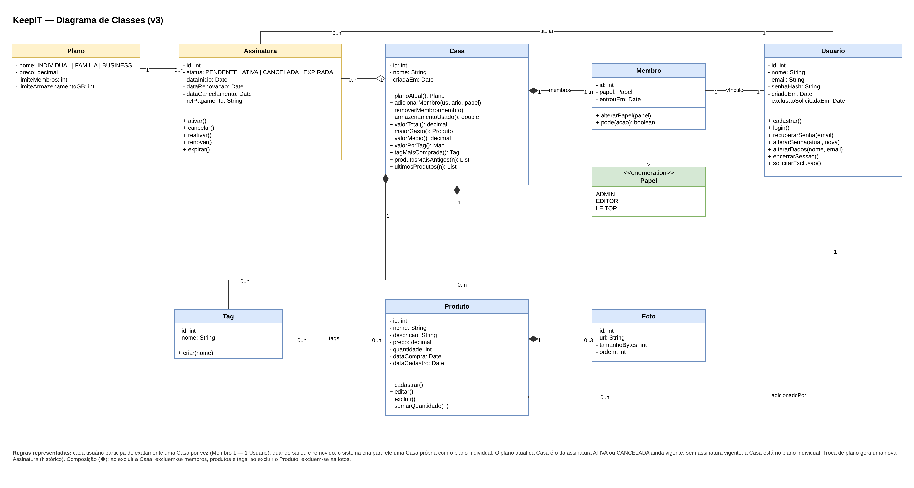

## 5.2 Diagrama de Classes

O diagrama de classes representa a estrutura do sistema: as entidades do domínio, seus atributos, suas operações e como elas se relacionam. Ele é a base do modelo de dados (Diagrama ER), dos modelos do Prisma na API e dos tipos usados no front-end. Esta é a terceira versão do diagrama. A segunda versão, feita na entrega de Modelagem de Sistemas, foi revisada para refletir as decisões tomadas na modelagem do produto. A Figura 20 apresenta o diagrama.

**Figura 20: Diagrama de Classes do KeepIT (v3)**

Fonte: Autoria própria apoiado por IA generativa (Claude, Anthropic), 2026.

As classes se organizam em três grupos:

(i) **Usuários e Casa:** o **Usuario** guarda os dados de acesso. A senha é armazenada apenas como hash, e o atributo `exclusaoSolicitadaEm` marca o pedido de exclusão, que a rotina agendada conclui em até 24 horas. A **Casa** é o inventário compartilhado e concentra as operações de estatística: valor total, maior gasto, valor médio, valor por tag, tag mais comprada, produtos mais antigos e últimos produtos. O **Membro** liga um usuário a uma Casa e guarda o seu **Papel** (ADMIN, EDITOR ou LEITOR). A operação `pode(acao)` responde se o papel permite uma ação, e é usada pelo controle de acesso da API.

(ii) **Inventário:** o **Produto** pertence a uma Casa e registra quem o adicionou. Cada produto pode ter até três **Fotos**, cujo tamanho é somado no armazenamento usado pela Casa. As **Tags** pertencem à Casa e se ligam aos produtos em uma relação de muitos para muitos. A operação `somarQuantidade(n)` implementa a opção de somar à quantidade quando o cadastro detecta um produto duplicado.

(iii) **Planos e assinatura:** o **Plano** define o preço, o limite de membros e o limite de armazenamento. A **Assinatura** liga uma Casa a um Plano, tem um usuário titular (quem paga) e passa pelos estados PENDENTE, ATIVA, CANCELADA e EXPIRADA, detalhados na máquina de estados. A Casa guarda o histórico das suas assinaturas, porque cada troca de plano gera uma assinatura nova. A operação `planoAtual()` da Casa devolve o plano da assinatura vigente ou, se não houver nenhuma, o plano Individual.

As mudanças em relação à versão 2 foram:

(iv) **Classe Membro no lugar da relação direta entre Usuario e Papel:** o papel depende da Casa em que a pessoa está, e não da pessoa em si. Com a regra de que cada usuário participa de uma Casa por vez, a relação entre Membro e Usuario é de um para um. Quando um usuário sai de uma Casa, é removido ou tem a Casa expirada, o sistema cria para ele uma Casa própria com o plano Individual, garantindo que todo usuário sempre tenha uma Casa. A antiga relação "dono" foi retirada, porque o titular da Casa passa a ser o membro com papel ADMIN.

(v) **Histórico de assinaturas e titular:** a relação entre Casa e Assinatura deixou de ser só a assinatura atual e passou a guardar o histórico. A assinatura também passou a apontar para o titular, que pode ser um EDITOR ou LEITOR que assinou e criou uma Casa nova.

(vi) **Classe Foto e ajustes de atributos:** a foto saiu do Produto e virou uma classe, para permitir até três fotos por produto e somar o espaço ocupado. O armazenamento usado passou a ser calculado (`armazenamentoUsado()`) em vez de guardado, o método de pagamento passou a ser uma referência do gateway (`refPagamento`), sem guardar os dados do cartão, e os preços passaram a usar o tipo decimal, adequado a valores em dinheiro.

A Tabela 14 resume as classes e as regras de negócio que cada uma implementa.

**Tabela 14: Classes do sistema e regras de negócio**

| Classe | Responsabilidade | Regras de negócio | Módulo |
|---|---|---|---|
| Usuario | Identidade e acesso | Senha com hash; exclusão concluída em até 24 h | M1 |
| Casa | Inventário compartilhado e estatísticas | Plano atual vem da assinatura vigente; sem assinatura, plano Individual | M2, M4 |
| Membro | Vínculo entre usuário e Casa | Uma Casa por usuário por vez; limite de membros do plano | M2 |
| Papel | Permissões | ADMIN gerencia tudo; EDITOR edita produtos e tags; LEITOR só consulta | M2 |
| Produto | Bem físico registrado | Duplicidade por nome na mesma Casa; somar quantidade | M3 |
| Foto | Imagem do produto | Até 3 por produto; JPEG ou PNG até 5 MB; soma no armazenamento | M3 |
| Tag | Categoria definida pela Casa | Criada por ADMIN ou EDITOR; vários produtos por tag | M3 |
| Plano | Oferta comercial | Limites de membros e de armazenamento | M5 |
| Assinatura | Contrato da Casa com um plano | Estados PENDENTE, ATIVA, CANCELADA e EXPIRADA; troca de plano gera nova assinatura | M5 |

Fonte: Autoria própria apoiado por IA generativa (Claude, Anthropic), 2026.

Com essa versão, o diagrama de classes fica coerente com o protótipo, os requisitos e os processos BPMN, e pode ser convertido diretamente no modelo de dados apresentado na próxima seção.
