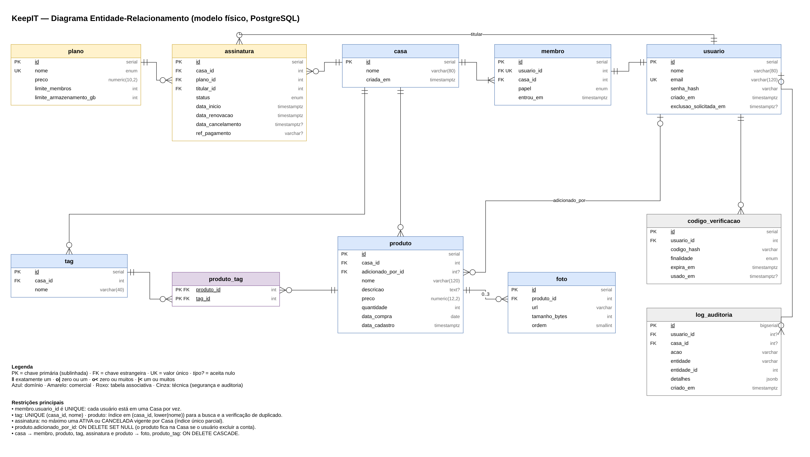

## 5.3 Diagrama ER

O Diagrama Entidade-Relacionamento (ER) apresenta o modelo físico do banco de dados do KeepIT, ou seja, as tabelas que serão criadas no PostgreSQL, com suas colunas, tipos, chaves e relacionamentos. Ele foi derivado do Diagrama de Classes (seção 5.2): cada classe do domínio virou uma tabela, a relação de muitos para muitos entre Produto e Tag virou uma tabela associativa, e foram acrescentadas duas tabelas técnicas que não aparecem no modelo de domínio, mas são exigidas pelos requisitos. A Figura 21 apresenta o diagrama, na notação "pé de galinha" (crow's foot).

**Figura 21: Diagrama ER do KeepIT (modelo físico)**

Fonte: Autoria própria apoiado por IA generativa (Claude, Anthropic), 2026.

O modelo se organiza da seguinte forma:

(i) **Tabelas de domínio:** `usuario`, `casa`, `membro`, `produto`, `foto` e `tag` correspondem às classes de mesmo nome. A tabela `membro` liga cada usuário à sua Casa e guarda o papel. A coluna `usuario_id` dessa tabela é única, e é ela que garante no banco a regra de que cada usuário participa de uma Casa por vez.

(ii) **Tabelas comerciais:** `plano` guarda os três planos (Individual, Família e Business) e seus limites. `assinatura` registra cada contratação, com a Casa, o plano, o titular que paga e o estado atual. Um índice único parcial impede que uma Casa tenha mais de uma assinatura vigente (ATIVA ou CANCELADA ainda dentro do período) ao mesmo tempo.

(iii) **Tabela associativa:** `produto_tag` implementa a relação de muitos para muitos entre produtos e tags, com chave primária composta pelas duas chaves estrangeiras.

(iv) **Tabelas técnicas:** `codigo_verificacao` guarda os códigos de 6 dígitos usados na recuperação de senha e na troca de e-mail (apenas o hash do código, com prazo de validade e marcação de uso). `log_auditoria` atende ao RNF05, registrando alterações de plano e de assinatura, cancelamentos e exclusões de produtos, com os detalhes em formato JSON.

(v) **Integridade e exclusões:** ao excluir uma Casa, são excluídos em cascata os seus membros, produtos, tags e assinaturas, e ao excluir um produto são excluídas as suas fotos e tags associadas. Quando um usuário exclui a conta, os produtos que ele cadastrou continuam na Casa, e o campo `adicionado_por_id` passa a ficar vazio. Isso atende ao direito ao esquecimento (RNF16) sem apagar o inventário dos outros membros.

(vi) **Desempenho:** a busca de produtos e a verificação de duplicado usam um índice em `casa_id` e no nome em letras minúsculas, e as tags têm o nome único dentro de cada Casa. Esses índices substituem, no MVP, o cache em Redis que ficou no backlog (RNF03).

(vii) **Tipos:** valores em dinheiro usam `numeric`, que não tem erros de arredondamento; datas com horário usam `timestamptz`, que guarda o fuso; e a data de compra usa `date`, porque o usuário informa apenas o dia. Campos marcados com "?" aceitam valor nulo.

O modelo foi escrito também como um schema do Prisma (arquivo `schema.prisma`, anexo à documentação), validado com a própria ferramenta. Esse arquivo gera as tabelas da Figura 21 e será o ponto de partida do código da API. A Tabela 15 resume as tabelas.

**Tabela 15: Tabelas do banco de dados**

| Tabela | Conteúdo | Origem | Regras no banco | Requisitos |
|---|---|---|---|---|
| usuario | Dados de acesso do usuário | Classe Usuario | E-mail único | RF01, RF02, RF19, RF20 |
| casa | Inventário compartilhado | Classe Casa | Exclusão em cascata dos dados da Casa | RF32 |
| membro | Vínculo do usuário com a Casa e papel | Classe Membro | `usuario_id` único (uma Casa por vez) | RF25 a RF28, RNF13 |
| plano | Planos e limites | Classe Plano | Nome único | RF12, RF14 |
| assinatura | Contratações da Casa | Classe Assinatura | Uma assinatura vigente por Casa | RF13, RF16, RF37, RF38 |
| produto | Bens registrados | Classe Produto | Índice para busca e duplicado; autor fica nulo se a conta for excluída | RF03 a RF10, RF33, RF34 |
| foto | Fotos dos produtos | Classe Foto | Exclusão em cascata com o produto | RF05, RF39, RNF08, RNF09 |
| tag | Categorias da Casa | Classe Tag | Nome único por Casa | RF08, RF35 |
| produto_tag | Tags de cada produto | Relação Produto–Tag | Chave composta | RF08 |
| codigo_verificacao | Códigos de recuperação e troca de e-mail | Requisito técnico | Guarda só o hash; expira | RF17, RF19 |
| log_auditoria | Registro de eventos | Requisito técnico | Mantido mesmo se o usuário ou a Casa forem excluídos | RNF05 |

Fonte: Autoria própria apoiado por IA generativa (Claude, Anthropic), 2026.

Com o ER e o schema do Prisma alinhados ao diagrama de classes, o modelo de dados está pronto para a implementação: a primeira tarefa da fase de desenvolvimento será gerar o banco a partir desse schema e popular a tabela de planos.
