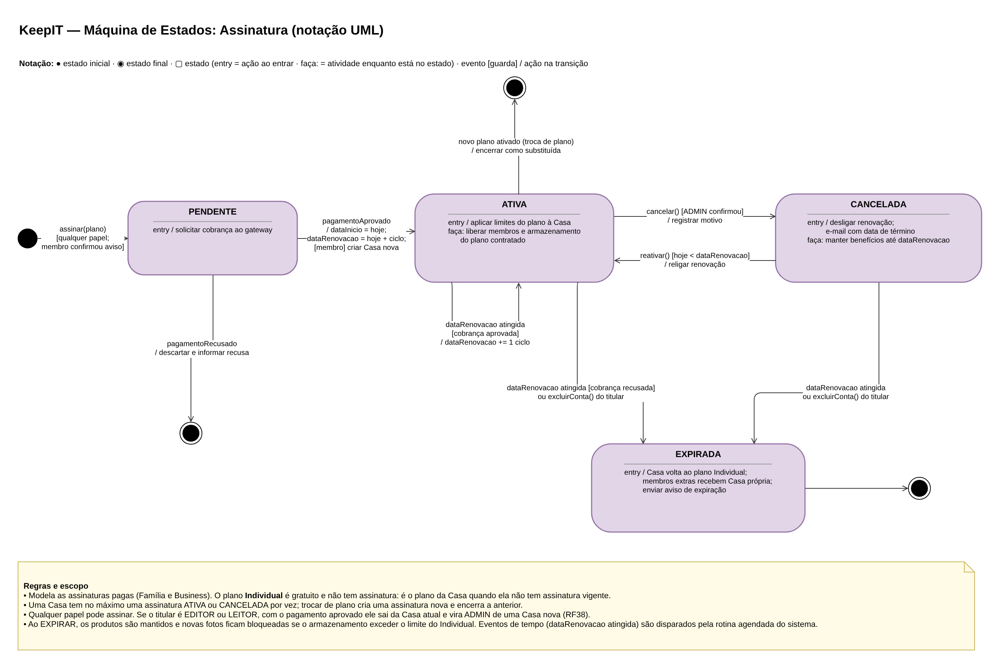
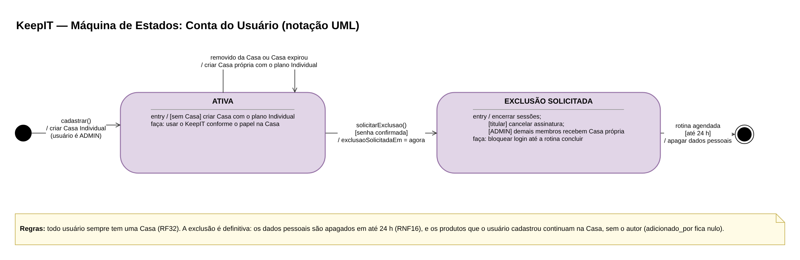

## 5.4 Diagrama de Estados

O diagrama de estados (máquina de estados) mostra as situações pelas quais um objeto passa ao longo da sua vida, os eventos que provocam cada mudança e as ações executadas nessas mudanças. No KeepIT, dois objetos têm ciclo de vida com regras de negócio importantes: a assinatura, que concentra as regras de cobrança, cancelamento e expiração, e a conta do usuário, que tem a regra de exclusão em até 24 horas. As duas máquinas usam a notação UML: em cada transição aparece o evento, a condição entre colchetes e a ação depois da barra.

A máquina de estados da assinatura foi feita na entrega de Modelagem de Sistemas e foi revisada para refletir duas decisões posteriores: qualquer papel pode assinar um plano, e o plano Individual não tem assinatura, sendo o plano da Casa quando não há assinatura vigente. A máquina da conta do usuário é nova.

**Figura 24: Máquina de estados da Assinatura**

Fonte: Autoria própria apoiado por IA generativa (Claude, Anthropic), 2026.

**Figura 25: Máquina de estados da Conta do Usuário**

Fonte: Autoria própria apoiado por IA generativa (Claude, Anthropic), 2026.

Os estados se comportam assim:

(i) **PENDENTE:** a assinatura nasce quando um usuário de qualquer papel assina um plano. Se ele não for ADMIN, precisa antes confirmar o aviso de que sairá da Casa atual. O sistema solicita a cobrança ao gateway. Com o pagamento recusado, a assinatura é descartada.

(ii) **ATIVA:** com o pagamento aprovado, o sistema define a data de início e a de renovação e aplica os limites do plano à Casa. Se o titular era EDITOR ou LEITOR, é nesse momento que ele sai da Casa anterior e passa a ser ADMIN de uma Casa nova. A cada data de renovação, uma nova cobrança é feita; se for aprovada, a assinatura continua ATIVA. Se o ADMIN trocar de plano, a assinatura atual é encerrada e uma nova é criada.

(iii) **CANCELADA:** quando o ADMIN cancela, a renovação é desligada, mas os benefícios continuam até a data de renovação. Até lá, o ADMIN pode reativar a assinatura, que volta a ATIVA.

(iv) **EXPIRADA:** a assinatura expira quando a data de renovação chega depois de um cancelamento, quando a cobrança da renovação é recusada ou quando o titular exclui a conta. A Casa volta ao plano Individual, os membros extras recebem cada um uma Casa própria, e os produtos são mantidos. Se o armazenamento usado passar do limite do Individual, o envio de novas fotos fica bloqueado.

(v) **Conta ATIVA e EXCLUSÃO SOLICITADA:** a conta nasce no cadastro, já com uma Casa no plano Individual. Sempre que o usuário fica sem Casa (porque foi removido ou porque a Casa expirou), o sistema cria uma Casa própria para ele, garantindo que todo usuário sempre tenha uma Casa. Quando o usuário pede a exclusão e confirma a senha, as sessões são encerradas, a assinatura é cancelada se ele for o titular, e o login fica bloqueado. A rotina agendada apaga os dados pessoais em até 24 horas, e os produtos que ele cadastrou continuam na Casa, sem o autor.

A Tabela 16 resume os estados e onde cada um aparece no sistema.

**Tabela 16: Estados da assinatura e da conta**

| Objeto | Estado | Como entra | Como sai | Telas e requisitos |
|---|---|---|---|---|
| Assinatura | PENDENTE | Usuário assina um plano | Pagamento aprovado (ATIVA) ou recusado (descartada) | 13, 14, 24 · RF13, RF15, RF38 |
| Assinatura | ATIVA | Pagamento aprovado ou reativação | Cancelamento, troca de plano, renovação recusada ou exclusão da conta do titular | 05, 15 · RF13 |
| Assinatura | CANCELADA | ADMIN cancela | Reativação (ATIVA) ou data de renovação (EXPIRADA) | 15 · RF16 |
| Assinatura | EXPIRADA | Fim do período sem renovação | Estado final | Rotina agendada · RF37 |
| Conta | ATIVA | Cadastro | Pedido de exclusão confirmado | 03, 16 · RF02, RF32 |
| Conta | EXCLUSÃO SOLICITADA | Pedido de exclusão com senha | Rotina apaga os dados em até 24 h | 21 · RF20, RNF16 |

Fonte: Autoria própria apoiado por IA generativa (Claude, Anthropic), 2026.

As duas máquinas de estados definem exatamente quais mudanças são permitidas. Na implementação, cada transição vira uma operação da API que confere o estado atual antes de agir (por exemplo, só é possível reativar uma assinatura CANCELADA cuja data de renovação ainda não passou), e os eventos de tempo são tratados pela rotina agendada descrita na arquitetura técnica.
