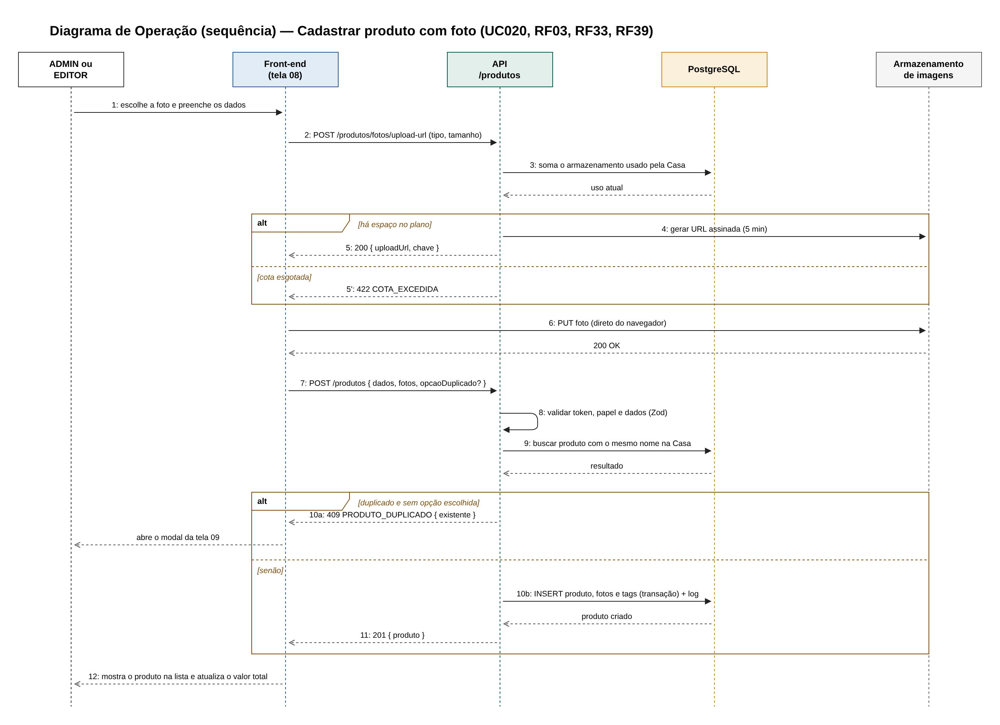
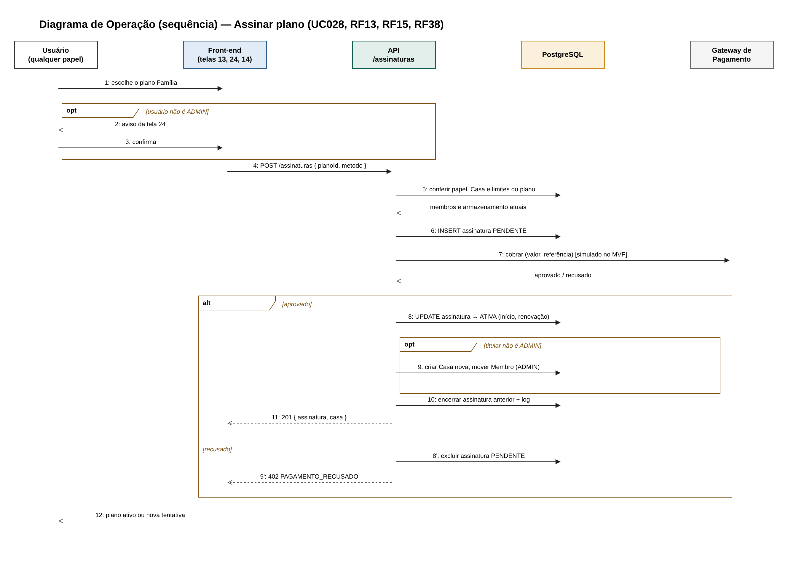

## 5.5 Diagrama de Operação

O diagrama de operação mostra como as operações do sistema acontecem: quais componentes participam, em que ordem trocam mensagens e o que cada operação exige e garante. Ele foi feito em duas partes. Primeiro, diagramas de sequência da UML para as duas operações com mais regras e mais componentes envolvidos: o cadastro de produto com foto e a assinatura de plano. Depois, uma tabela com o contrato de cada operação da API, com entrada, pré-condições, pós-condições e erros. Juntos, eles detalham o comportamento que as classes, os casos de uso e as máquinas de estado descrevem de forma mais geral.

**Figura 26: Sequência da operação Cadastrar produto com foto**

Fonte: Autoria própria apoiado por IA generativa (Claude, Anthropic), 2026.

**Figura 27: Sequência da operação Assinar plano**

Fonte: Autoria própria apoiado por IA generativa (Claude, Anthropic), 2026.

Os diagramas de sequência mostram:

(i) **Participantes:** o usuário, o front-end (com as telas envolvidas), a API, o banco de dados e o serviço externo da operação (armazenamento de imagens ou gateway de pagamento). As setas cheias são chamadas, as tracejadas são respostas, e os blocos "alt" e "opt" representam caminhos alternativos e opcionais, com a condição entre colchetes.

(ii) **Cadastrar produto com foto (Figura 26):** antes de enviar a foto, o front-end pede à API uma URL de envio. A API confere se ainda há espaço no plano da Casa e, se houver, gera uma URL assinada que vale por 5 minutos; se não houver, responde com o erro de cota excedida. O navegador envia a foto direto para o armazenamento, sem passar pela API. Em seguida, o front-end envia os dados do produto. A API valida o token, o papel e os dados, procura um produto com o mesmo nome na Casa e, se encontrar e o usuário ainda não tiver escolhido o que fazer, responde com o erro de conflito, que abre o modal da tela 09. Caso contrário, grava o produto, as fotos e as tags em uma única transação e registra o log.

(iii) **Assinar plano (Figura 27):** se o usuário não for ADMIN, o front-end mostra o aviso da tela 24 antes de continuar. A API confere se os membros e o armazenamento atuais cabem no plano, cria a assinatura como PENDENTE e pede a cobrança ao gateway (simulado no MVP). Se o pagamento for aprovado, a assinatura passa a ATIVA; quando o titular não é ADMIN, é nesse momento que a API cria a Casa nova e move o membro, e a assinatura anterior é encerrada. Se for recusado, a assinatura pendente é excluída e o usuário pode tentar outro método.

A Tabela 17 apresenta o contrato das operações da API, organizadas por módulo. Cada operação corresponde a uma rota da API REST.

**Tabela 17: Contratos das operações da API**

| Operação | Quem pode | Entrada | Pré-condições | Pós-condições | Erros | UC / RF |
|---|---|---|---|---|---|---|
| **M1 · Autenticação e Conta** | | | | | | |
| POST /auth/cadastro | Visitante | nome, e-mail, senha | E-mail ainda não cadastrado; senha com 8 ou mais caracteres | Usuário criado; Casa criada com o plano Individual; usuário é ADMIN da Casa | 409 EMAIL_EM_USO; 422 DADOS_INVALIDOS | UC008 · RF02, RF32 |
| POST /auth/login | Visitante | e-mail, senha | Conta ativa (sem exclusão solicitada) | Token JWT emitido | 401 CREDENCIAIS_INVALIDAS; 429 MUITAS_TENTATIVAS | UC004, UC005 · RF01 |
| POST /auth/recuperar-senha | Visitante | e-mail | Conta existente | Código de 6 dígitos gerado (guardado só o hash), válido por 15 min, enviado por e-mail | 404 CONTA_NAO_ENCONTRADA; 429 | UC006 · RF17 |
| POST /auth/redefinir-senha | Visitante | e-mail, código, nova senha | Código válido, não usado e dentro do prazo | Senha trocada; código marcado como usado; sessões encerradas | 400 CODIGO_INVALIDO | UC007, UC009 · RF17 |
| POST /auth/logout | Usuário | — | Sessão ativa | Sessão encerrada | — | UC012 · RF21 |
| PATCH /me | Usuário | nome, e-mail | Novo e-mail único e confirmado por código | Dados atualizados | 409 EMAIL_EM_USO | UC015 · RF18, RF19 |
| PATCH /me/senha | Usuário | senha atual, nova senha | Senha atual correta | Senha atualizada | 401 SENHA_INCORRETA | UC010, UC011 · RF31 |
| DELETE /me | Usuário | senha | Senha correta | Exclusão registrada; sessões encerradas; assinatura cancelada se for titular; outros membros recebem Casa própria se for ADMIN | 401 SENHA_INCORRETA | UC013, UC014 · RF20 |
| **M2 · Casa e Membros** | | | | | | |
| GET /casa/membros | Qualquer papel | — | Usuário logado | Lista de membros, papéis e limite do plano | — | UC018, UC037 · RF25 |
| POST /casa/membros | ADMIN | e-mail, papel | Conta existente; número de membros abaixo do limite do plano | Membro vinculado com o papel; sai da Casa anterior; aviso por e-mail | 403 SEM_PERMISSAO; 404; 409 LIMITE_MEMBROS | UC033, UC034 · RF26 |
| PATCH /casa/membros/:id | ADMIN | papel | Membro da mesma Casa e diferente do próprio ADMIN | Papel alterado; log registrado | 403; 404 | UC036 · RF28 |
| DELETE /casa/membros/:id | ADMIN | — | Membro da mesma Casa e diferente do próprio ADMIN | Membro desvinculado e com Casa própria no plano Individual; produtos dele continuam na Casa | 403; 404 | UC035 · RF27 |
| **M3 · Produtos e Tags** | | | | | | |
| GET /produtos | Qualquer papel | busca, tag | Usuário logado | Produtos da Casa filtrados | — | UC016 · RF10, RF34 |
| GET /produtos/:id | Qualquer papel | — | Produto da Casa do usuário | Detalhe com fotos, tags e autor | 404 | UC024 · RF36 |
| POST /produtos/fotos/upload-url | ADMIN, EDITOR | tipo, tamanho | JPEG ou PNG com até 5 MB; espaço disponível no plano | URL assinada válida por 5 minutos | 403; 422 ARQUIVO_INVALIDO; 422 COTA_EXCEDIDA | UC021 · RF05, RF39 |
| POST /produtos | ADMIN, EDITOR | dados, fotos (até 3), tags, opção para duplicado | Dados válidos; se houver duplicado, opção escolhida | Produto criado, ou quantidade somada ao existente; log registrado | 403; 409 PRODUTO_DUPLICADO; 422 | UC020, UC022 · RF03, RF33 |
| PATCH /produtos/:id | ADMIN, EDITOR | campos alterados | Produto da Casa do usuário | Produto atualizado; log registrado | 403; 404; 422 | UC025 · RF04 a RF08 |
| DELETE /produtos/:id | ADMIN, EDITOR | — | Produto da Casa do usuário | Produto, fotos e vínculos com tags removidos; log registrado | 403; 404 | UC026 · RF09 |
| POST /tags | ADMIN, EDITOR | nome | Nome ainda não usado na Casa | Tag criada | 403; 409 TAG_EXISTENTE | UC023 · RF35 |
| **M4 · Estatísticas** | | | | | | |
| GET /estatisticas | Qualquer papel | — | Usuário logado | Valor total, maior gasto, valor médio, valor por tag, tag mais comprada, mais antigos, armazenamento | — | UC017, UC027 · RF23, RF24 |
| **M5 · Planos e Assinatura** | | | | | | |
| GET /planos | Qualquer papel | — | — | Planos com preço e limites | — | UC019 · RF12, RF14 |
| POST /assinaturas | Qualquer papel | plano, método de pagamento, confirmação do aviso | Se não for ADMIN, aviso confirmado; membros e armazenamento cabem no plano | Assinatura ATIVA; se o titular era membro, Casa nova com ele como ADMIN; assinatura anterior encerrada; log registrado | 402 PAGAMENTO_RECUSADO; 422 PLANO_NAO_COMPORTA | UC028 a UC030 · RF13, RF15, RF38 |
| POST /assinaturas/atual/cancelar | ADMIN | motivo (opcional) | Assinatura ATIVA | Assinatura CANCELADA; renovação desligada; e-mail com a data de término | 403; 409 ESTADO_INVALIDO | UC031 · RF16 |
| POST /assinaturas/atual/reativar | ADMIN | — | Assinatura CANCELADA e data de renovação ainda não alcançada | Assinatura ATIVA; renovação religada | 403; 409 ESTADO_INVALIDO | UC031 · RF16 |
| POST /internal/jobs | Rotina agendada (chave interna) | — | Chamada autenticada pelo workflow agendado | Assinaturas vencidas renovadas ou EXPIRADAS; contas com exclusão solicitada há mais de 24 h apagadas | 401 | RF37 · RNF16 |

Fonte: Autoria própria apoiado por IA generativa (Claude, Anthropic), 2026.

Os contratos seguem padrões comuns a todas as operações: toda rota, exceto as de visitante e a da rotina, exige o token de login; as permissões são conferidas na API (RNF31); os erros têm um código fixo, que o front-end usa para mostrar a mensagem correta; e as operações que alteram plano, assinatura ou exclusão de produtos registram um log de auditoria (RNF05). Essa tabela é a base da especificação da API na fase de desenvolvimento: cada linha vira uma rota, e as pré-condições, pós-condições e erros viram os testes automáticos.
