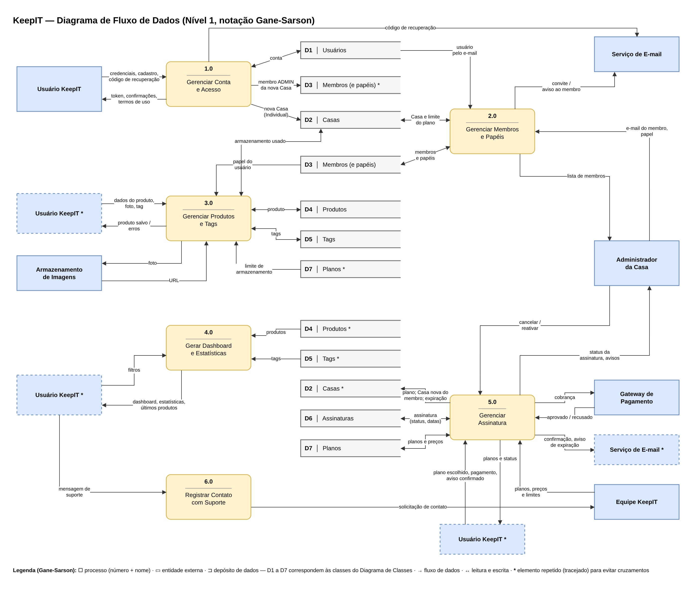

## 5.6 Diagrama de Fluxo de Dados

O Diagrama de Fluxo de Dados (DFD) mostra como as informações entram no KeepIT, são transformadas pelos processos do sistema, ficam guardadas nos depósitos de dados e saem para os usuários e sistemas externos. Ele detalha, em nível 1, o processo único do Diagrama de Contexto (seção 5.9). O diagrama usa a notação Gane-Sarson: processos com cantos arredondados, entidades externas em retângulos e depósitos de dados abertos à direita. Elementos repetidos, marcados com asterisco e contorno tracejado, evitam o cruzamento de linhas.

O DFD foi feito na entrega de Modelagem de Sistemas e foi revisado para acompanhar o modelo de dados atual: o plano Individual deixou de ter assinatura, o papel passou a ficar no vínculo do membro com a Casa, e qualquer usuário pode assinar um plano. A Figura 28 apresenta o diagrama.

**Figura 28: DFD nível 1 do KeepIT**

Fonte: Autoria própria apoiado por IA generativa (Claude, Anthropic), 2026.

O diagrama tem seis processos:

(i) **1.0 Gerenciar Conta e Acesso:** recebe cadastro, credenciais e pedidos de recuperação de senha. No cadastro, grava o usuário (D1), cria a Casa com o plano Individual (D2) e registra o usuário como membro ADMIN dessa Casa (D3). Envia o código de recuperação pelo serviço de e-mail.

(ii) **2.0 Gerenciar Membros e Papéis:** recebe do administrador o e-mail e o papel do novo membro, encontra o usuário em D1, confere o limite do plano em D2, grava o vínculo e o papel em D3 e avisa o membro por e-mail.

(iii) **3.0 Gerenciar Produtos e Tags:** recebe os dados e as fotos dos produtos, consulta o papel do usuário (D3), o armazenamento usado (D2) e o limite do plano (D7), envia as fotos ao armazenamento de imagens e grava produtos e tags (D4 e D5).

(iv) **4.0 Gerar Dashboard e Estatísticas:** lê produtos e tags (D4 e D5) e devolve o valor total, as estatísticas e os últimos produtos adicionados.

(v) **5.0 Gerenciar Assinatura:** recebe de qualquer usuário o plano escolhido, o pagamento e a confirmação do aviso de nova Casa, e do administrador os pedidos de cancelamento e reativação. Troca dados de cobrança com o gateway de pagamento, grava a assinatura (D6), atualiza a Casa (D2), inclusive criando a Casa nova quando quem assina é um membro, e envia confirmações e avisos de expiração por e-mail. A Equipe KeepIT mantém os planos, preços e limites (D7).

(vi) **6.0 Registrar Contato com Suporte:** encaminha as mensagens dos usuários para a Equipe KeepIT.

A Tabela 18 relaciona os depósitos de dados às tabelas do banco.

**Tabela 18: Depósitos de dados do DFD**

| Depósito | Conteúdo | Tabela no banco (Diagrama ER) | Processos que usam |
|---|---|---|---|
| D1 Usuários | Contas e credenciais | usuario, codigo_verificacao | 1.0, 2.0 |
| D2 Casas | Casas, plano vigente e armazenamento | casa | 1.0, 2.0, 3.0, 5.0 |
| D3 Membros (e papéis) | Vínculo de cada usuário com a Casa e seu papel | membro | 1.0, 2.0, 3.0 |
| D4 Produtos | Produtos e fotos | produto, foto | 3.0, 4.0 |
| D5 Tags | Tags e vínculos com produtos | tag, produto_tag | 3.0, 4.0 |
| D6 Assinaturas | Assinaturas e estados | assinatura | 5.0 |
| D7 Planos | Planos, preços e limites | plano | 3.0, 5.0 |

Fonte: Autoria própria apoiado por IA generativa (Claude, Anthropic), 2026.

Os seis processos do DFD correspondem aos módulos da arquitetura funcional (1.0 ao M1, 2.0 ao M2, 3.0 ao M3, 4.0 ao M4 e 5.0 ao M5, com o 6.0 como apoio), e os depósitos correspondem às tabelas do Diagrama ER. Assim, o fluxo das informações, a organização do código e o banco de dados seguem a mesma divisão.
