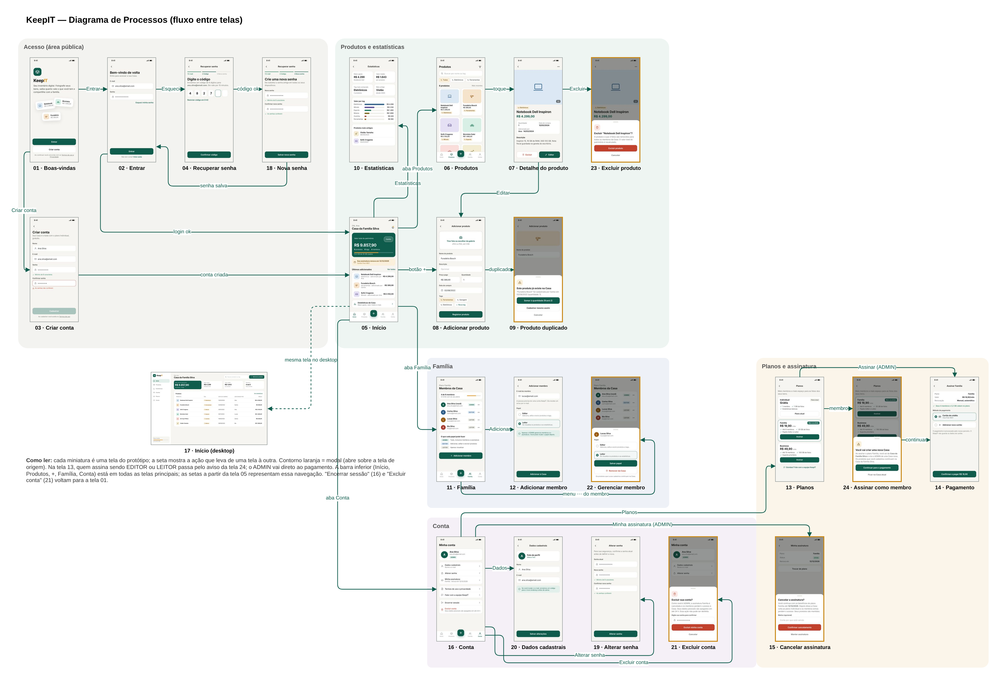

## 5.7 Diagrama de Processos (Telas)

O diagrama de processos das telas mostra como o usuário navega pelo KeepIT: cada miniatura é uma tela do protótipo, e cada seta indica a ação que leva de uma tela à outra. Enquanto o sitemap (seção 1.1) mostra a hierarquia das telas, este diagrama mostra o caminho percorrido em cada tarefa, incluindo os modais e os retornos. A Figura 29 apresenta o diagrama, com as telas agrupadas pelas mesmas áreas do sitemap.

**Figura 29: Diagrama de processos (fluxo entre telas)**

Fonte: Autoria própria apoiado por IA generativa (Claude, Anthropic), 2026.

Os principais fluxos são:

(i) **Acesso:** a partir das Boas-vindas (01), o visitante entra (02) ou cria a conta (03); os dois caminhos terminam no Início (05). A recuperação de senha passa pelo código (04) e pela nova senha (18) e volta para o login.

(ii) **Início como centro da navegação:** o Início (05) é a tela para onde o usuário vai depois do login, e dele partem as entradas da barra inferior: Produtos (06), o botão "+" de adicionar produto (08), Família (11) e Conta (16), além do atalho para as Estatísticas (10). No desktop, a mesma tela é apresentada no formato largo (17).

(iii) **Produtos:** da lista (06), o usuário abre o detalhe (07), de onde pode editar, reaproveitando o formulário da tela 08, ou excluir, confirmando no modal (23). No cadastro (08), um nome repetido abre o modal de produto duplicado (09).

(iv) **Família:** da lista de membros (11), o ADMIN adiciona um membro (12) ou abre o menu de um membro para mudar o papel ou removê-lo (22).

(v) **Conta e planos:** da Conta (16), o usuário acessa os dados cadastrais (20), a alteração de senha (19), a exclusão da conta (21) e os Planos (13). Nos Planos, o ADMIN vai direto ao pagamento (14), enquanto o EDITOR ou LEITOR passa antes pelo aviso de nova Casa (24). O ADMIN também acessa a assinatura atual e o cancelamento (15).

A Tabela 19 lista as transições do diagrama.

**Tabela 19: Transições entre telas**

| De | Ação | Para | Caso de uso |
|---|---|---|---|
| 01 Boas-vindas | Entrar / Criar conta | 02 Entrar / 03 Criar conta | UC001, UC002 |
| 02 Entrar | Login válido | 05 Início | UC004 |
| 02 Entrar | Esqueci minha senha | 04 Recuperar senha → 18 Nova senha → 02 | UC006, UC007, UC009 |
| 03 Criar conta | Conta criada | 05 Início | UC008 |
| 05 Início | Estatísticas da Casa | 10 Estatísticas | UC027 |
| 05 Início (barra inferior) | Produtos / + / Família / Conta | 06 / 08 / 11 / 16 | UC016, UC020, UC018, — |
| 06 Produtos | Toque no produto | 07 Detalhe | UC024 |
| 07 Detalhe | Editar / Excluir | 08 (edição) / 23 Excluir produto | UC025, UC026 |
| 08 Adicionar produto | Nome repetido na Casa | 09 Produto duplicado | UC020 |
| 11 Família | Adicionar membro / menu ⋯ | 12 Adicionar membro / 22 Gerenciar membro | UC033, UC035, UC036 |
| 16 Conta | Dados / Alterar senha / Excluir conta | 20 / 19 / 21 | UC015, UC010, UC013 |
| 16 Conta | Planos / Minha assinatura | 13 Planos / 15 Cancelar assinatura | UC019, UC031 |
| 13 Planos | Assinar (ADMIN) / Assinar (membro) | 14 Pagamento / 24 → 14 | UC028 |
| 16 Conta | Encerrar sessão | 01 Boas-vindas | UC012 |

Fonte: Autoria própria apoiado por IA generativa (Claude, Anthropic), 2026.

Esse diagrama define as rotas do front-end: cada tela vira uma rota do React Router, cada modal vira um componente aberto sobre a tela de origem, e cada seta é um caminho que deve ser testado na navegação do MVP.
