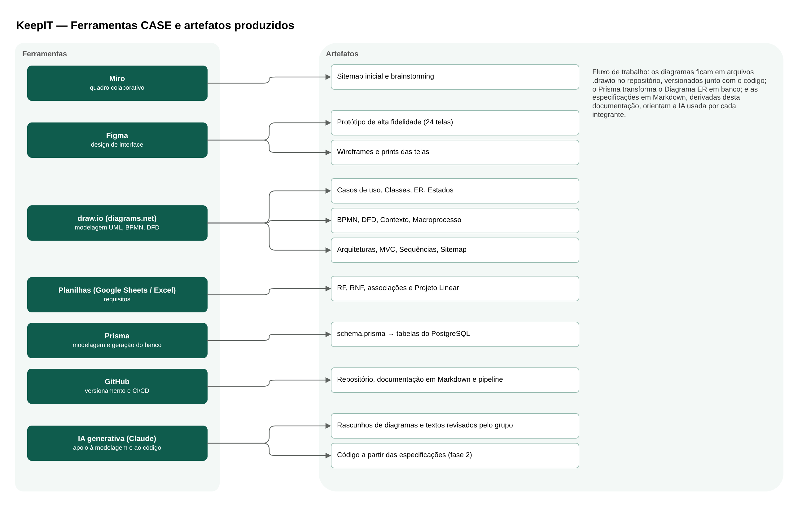

## 5.8 Ferramenta CASE

Ferramentas CASE (Computer-Aided Software Engineering) são programas que apoiam as atividades de engenharia de software, como a modelagem, a documentação, o design de interface e a geração de código. No KeepIT, o grupo combinou ferramentas especializadas, cada uma usada na etapa em que funciona melhor, e manteve todos os arquivos editáveis para que a documentação possa evoluir junto com o sistema. A Figura 30 mostra as ferramentas e os artefatos produzidos com cada uma.

**Figura 30: Ferramentas CASE e artefatos produzidos**

Fonte: Autoria própria apoiado por IA generativa (Claude, Anthropic), 2026.

O papel de cada ferramenta foi:

(i) **draw.io (diagrams.net):** é a principal ferramenta de modelagem do projeto. Foi usada para os diagramas UML (casos de uso, classes, estados e sequências), o Diagrama ER, o BPMN, o DFD, o Diagrama de Contexto, o macroprocesso, as arquiteturas e o sitemap. Foi escolhida por ser gratuita, ter bibliotecas de formas para UML, BPMN e diagramas de dados, e salvar os diagramas em arquivos de texto (.drawio) que podem ser versionados no GitHub e editados por qualquer integrante.

(ii) **Figma:** foi usado para o protótipo de alta fidelidade com 24 telas. O mesmo protótipo tem uma versão em HTML, de onde saíram os wireframes e os prints usados na documentação. O Figma permite que o grupo comente e edite o mesmo arquivo e serve de referência visual para a implementação do front-end.

(iii) **Miro:** foi usado nas etapas iniciais, como quadro colaborativo para o brainstorming e o primeiro sitemap do produto.

(iv) **Planilhas:** a planilha de requisitos, com os requisitos funcionais e não funcionais, as associações e o Projeto Linear, foi mantida no Google Sheets e exportada para Excel na revisão.

(v) **Prisma:** é ao mesmo tempo ferramenta de modelagem e de geração. O arquivo `schema.prisma` descreve o modelo de dados do Diagrama ER e gera automaticamente as tabelas do PostgreSQL e as migrations, o que garante que o banco implementado seja igual ao modelado.

(vi) **GitHub:** guarda o código, os arquivos de diagrama e a documentação em Markdown no mesmo repositório, e executa a integração e a entrega contínuas.

(vii) **IA generativa (Claude, da Anthropic):** foi usada como apoio na revisão da modelagem, na geração dos rascunhos dos diagramas e dos textos, que foram revisados e validados pelo grupo, e será usada na fase de desenvolvimento para gerar código a partir das especificações. Por isso, todas as figuras e tabelas deste documento indicam "Autoria própria apoiado por IA generativa".

A Tabela 20 resume as ferramentas.

**Tabela 20: Ferramentas CASE utilizadas**

| Ferramenta | Tipo | Uso no projeto | Formato dos arquivos |
|---|---|---|---|
| draw.io | Modelagem (upper CASE) | Diagramas UML, ER, BPMN, DFD, Contexto e arquitetura | .drawio (XML) e PNG |
| Figma | Design de interface | Protótipo, wireframes e prints | Arquivo Figma e PNG |
| Miro | Colaboração | Brainstorming e sitemap inicial | Quadro online |
| Google Sheets / Excel | Documentação de requisitos | RF, RNF, associações e Projeto Linear | .xlsx |
| Prisma | Modelagem e geração (lower CASE) | Modelo de dados, banco e migrations | schema.prisma |
| GitHub | Gestão de configuração | Versionamento, revisão e CI/CD | Repositório Git |
| Claude (IA generativa) | Assistente de modelagem e código | Rascunhos de diagramas e textos; código na fase 2 | Markdown e código-fonte |

Fonte: Autoria própria apoiado por IA generativa (Claude, Anthropic), 2026.

Com essas ferramentas, a documentação deixa de ser um entregável isolado e passa a fazer parte do repositório do sistema: os diagramas, os requisitos e as especificações ficam ao lado do código, podem ser atualizados por qualquer integrante e servem de contexto para a IA usada no desenvolvimento.
