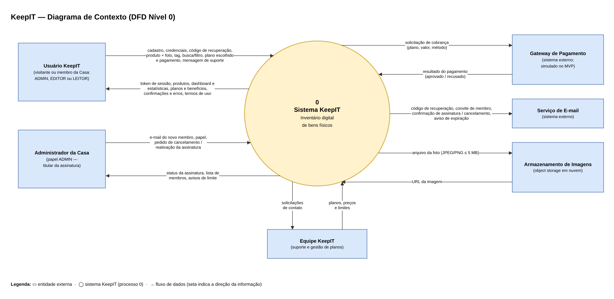

## 5.9 Diagrama de Contexto

O Diagrama de Contexto, ou DFD de nível 0, mostra o KeepIT como um único processo e as entidades externas que trocam informações com ele. Ele define a fronteira do sistema, ou seja, o que é responsabilidade do KeepIT e o que pertence a pessoas e sistemas de fora. O diagrama foi feito na entrega de Modelagem de Sistemas e foi revisado para refletir que qualquer usuário pode contratar um plano e que o pagamento é simulado no MVP. A Figura 31 apresenta o diagrama.

**Figura 31: Diagrama de Contexto do KeepIT**

Fonte: Autoria própria apoiado por IA generativa (Claude, Anthropic), 2026.

As entidades externas e seus fluxos são:

(i) **Usuário KeepIT:** o visitante ou qualquer membro da Casa. Envia cadastro, credenciais, códigos de recuperação, produtos com fotos, tags, buscas, o plano escolhido com o pagamento e mensagens de suporte. Recebe o token de sessão, os produtos, o dashboard, as estatísticas, os planos, as confirmações e os termos de uso.

(ii) **Administrador da Casa:** o membro com papel ADMIN. Além do que qualquer usuário faz, envia os dados de novos membros e seus papéis e os pedidos de cancelamento e reativação da assinatura, e recebe a lista de membros, o status da assinatura e os avisos de limite.

(iii) **Gateway de Pagamento:** recebe as solicitações de cobrança e devolve se o pagamento foi aprovado ou recusado. No MVP, essa integração é simulada.

(iv) **Serviço de E-mail:** entrega os códigos de recuperação, os avisos de novo membro, as confirmações de assinatura e cancelamento e os avisos de expiração.

(v) **Armazenamento de Imagens:** guarda as fotos dos produtos e devolve o endereço de cada imagem.

(vi) **Equipe KeepIT:** recebe as solicitações de contato e mantém os planos, preços e limites.

A Tabela 21 resume as entidades externas.

**Tabela 21: Entidades externas do Diagrama de Contexto**

| Entidade | Tipo | Envia ao KeepIT | Recebe do KeepIT |
|---|---|---|---|
| Usuário KeepIT | Pessoa | Cadastro, login, produtos, fotos, tags, plano e pagamento, suporte | Sessão, produtos, estatísticas, planos, confirmações |
| Administrador da Casa | Pessoa (papel ADMIN) | Membros e papéis, cancelamento e reativação | Membros, status da assinatura, avisos |
| Gateway de Pagamento | Sistema externo (simulado no MVP) | Resultado do pagamento | Solicitações de cobrança |
| Serviço de E-mail | Sistema externo | — | Mensagens a enviar |
| Armazenamento de Imagens | Sistema externo | Endereço das imagens | Arquivos das fotos |
| Equipe KeepIT | Pessoas da empresa | Planos, preços e limites | Solicitações de contato |

Fonte: Autoria própria apoiado por IA generativa (Claude, Anthropic), 2026.

As mesmas entidades aparecem como atores secundários nos diagramas de caso de uso e como sistemas externos nas arquiteturas funcional e técnica. Essa coerência garante que todas as integrações do sistema estejam previstas desde a modelagem até a implementação.
